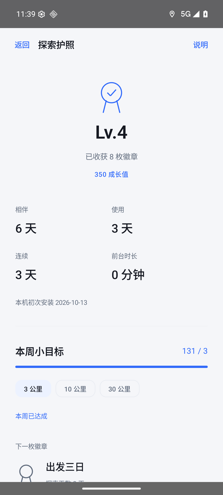
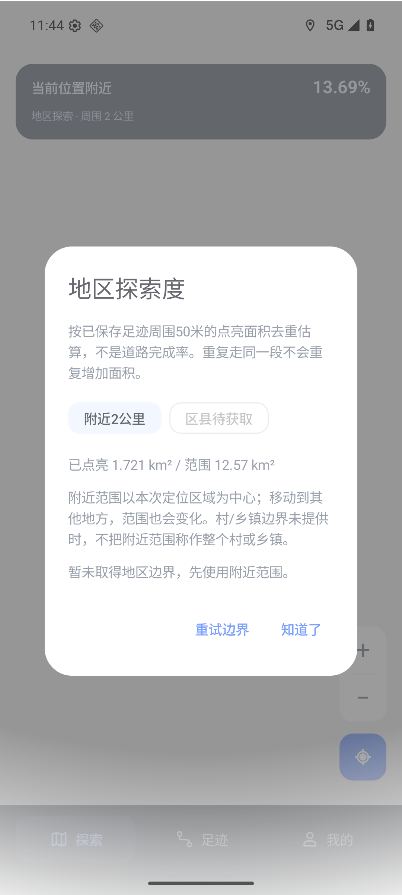

# v0.59 探索护照与地区进度

本轮在 v0.58 的高德与50米揭雾基础上增加探索护照、附近/区县面积统计和集中后台设置。名称与图标保持不变。首页只展示当前地区进度，成长页的徽章墙、日历、统计解释按需展开。

## 验证

- 418 JVM、23 Python 检查通过，正式 ARM64 构建通过。
- API36 Google x86_64 AVD，ARM native bridge 实际加载高德；同签名 androidTest 驱动正式包。没有使用 MapLibre 替代主路径。
- 正式 APK SHA256：`4df12c03e87496f8ba19363350eb30da666ef8d04695d35783f37e77b3ab305b`。
- 高德运行探针通过，坐标往返误差约 0.000018 米。坐标对齐中心误差 1.414 像素、迷雾覆盖层变换误差 0；相机恢复通过。
- 真实成长页面、周目标保存并重开、已获得徽章身份保留、最近任务隐藏/恢复通过。截图为匿名合成记录，不代表用户真实进度。
- 地区卡片实际显示附近2公里的合成轨迹覆盖率13.69%，详情说明与计算范围一致。原生探针临时清除模拟器无关实时定位，并在结束恢复，避免把其他地区当成合成轨迹中心。
- 9000点合成轨迹，25次缩放采样均达到未知区域1044采样点全黑、已探索核心625像素可见；缺失位图保护通过。未降低既有阈值。

## 明确限制

本轮区县边界网络请求没有取得边界；已验收附近范围及诚实降级提示，未验收真实区县服务。村/乡镇没有边界时不伪造行政区域百分比。地图加载回调与雾像素通过不等于完整道路瓦片已下载；该 AVD 未显示完整道路底图。

实体手机未连接，用户及女朋友的手机底图、户外定位、厂商自启动/关联启动、锁屏长时间记录和本人系统覆盖安装均未验收。隐藏最近任务只改变任务卡片，不保证后台常驻。后台权限与安装确认仍由系统管理。

成长数据保存在本机独立偏好中，不更改已有足迹数据库；首次时间明确是本机初次安装。使用统计从功能启用后累计，当前不随业务备份迁移。原正式签名与数据库 schema3 保持，回退用后续递增版本，不卸载清数据、不覆盖旧发布。

## 截图与参考

高德行政区域接口：https://lbs.amap.com/api/android-sdk/guide/map-data/district 。最近任务行为：https://developer.android.com/reference/android/app/ActivityManager.AppTask#setExcludeFromRecents(boolean) 。未引入新的第三方代码。
