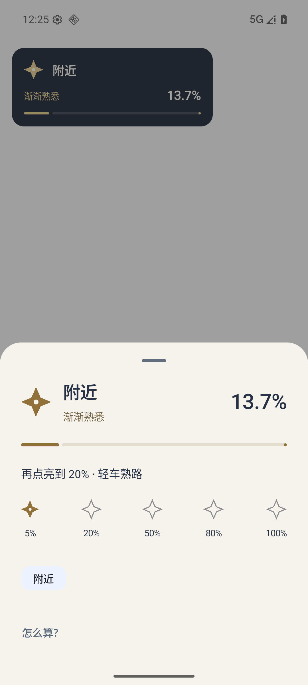

# v0.60 更轻松的界面

地图角落展示探索进度与阶段称号，轻触展开；后台设置改用短句。成长页只保留常用信息。

419 JVM通过；正式高德包成长/附近探索原生验证通过；25帧迷雾采样通过。旧测试把新控件算成地图露底，查看失败截图后只排除实际控件边界，地图阈值仍>98%，951采样点每帧全黑、核心625像素可见。地区测试隔离并恢复模拟器无关实时定位，保留原失败记录。

正式APK SHA256：`95c63cbcc3dbb9b76e568c401343e435c3fdaccafe45fdb1031d4fb054e9b8f9`。截图来自匿名测试数据。实体手机未连接，未声称用户认可审美或真机已经更新。原签名、包名和业务数据格式保持；回退使用后续递增版本。

区县网络仍未取得边界；完整道路瓦片和用户户外/锁屏路径未验收，附近进度按2公里范围。v0.59因用户反馈保留未发布草稿，直接交付v0.60。

