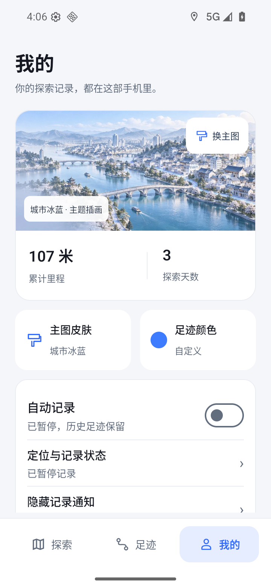
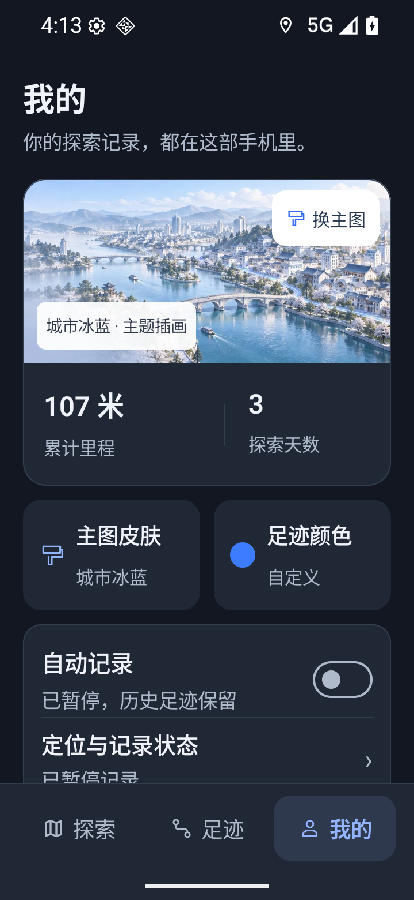

# v0.56 验证

范围：我的页面两张外观入口改为横向图文；备份页面按实际入口返回。没有改变 GPS、地图算法、资料结构或更新协议。

- 在 v0.55 正式包复现：我的 → 备份与数据 → 返回，错误进入更多设置。v0.56 使用系统返回和页头返回，分别验证直接入口回到我的、嵌套入口回到更多设置，均通过。
- `testDebugUnitTest assembleRelease assembleDebugAndroidTest lintRelease -PwalkpaintArm64Only=true` 通过：400 个 JVM 测试，其中 5 个新增返回路径用例。
- 两组 Python 工具测试共 41 个通过。
- 原签名覆盖安装 v0.55 → v0.56 后，原合成历史仍显示 107 米 / 3 天；覆盖前没有采集逐表摘要，因此不将此称作完整数据库升级校验。当前版本另以只读探针确认重启前后 trips、points、roads、road_matches、coverage 五表数量与 SHA256 完全一致。
- 真实原生渲染检查：浅色、深色、1.3 倍字号；外观选中和页面返回正常。代表截图附后。
- 正式包 AmapRuntimeProbe 通过：实际高德引擎地图加载完成；三个合成坐标往返最大误差 0.00001753 米。API 36 Google x86_64 AVD 通过 native bridge 运行 arm64 包；这不是 ARM 真机、户外或锁屏记录验收。
- 环境：本次拥有的只读 AVD WalkPaint_Google_API36_V044，720 × 1560 / 320 dpi。
- 包名 cn.walkpaint，v0.56 / code 64；release 不可调试。
- APK SHA256：`22fa70708adbdb2e8ca0856169f392563508eae822af6c47ef01edc2c3c39a50`。
- 原证书 SHA256：`21b74e3e2a10e12da8284d4e6bd7d99e55b00a385215902e94d7896f7a46c967`。

用户实体手机尚未验收。保留现有数据与备份，问题使用递增版本修复；不卸载、不降级数据库。

