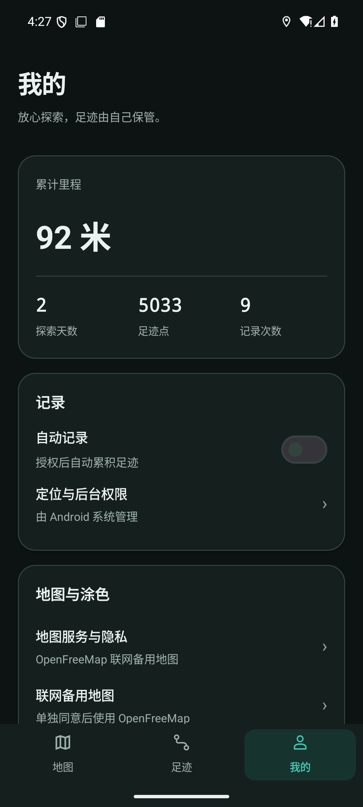

# 交付工具与结果验收

基线：已发布 v0.41，c46352eb2f700b78abeeb4d2f30b8271c08f0d01。本轮修改发布脚本、测试探针和验收，未改生产源码、版本或正式 APK。通用恢复模块与 h516df/android-update-kit PR #6 同源；源码指纹和测试包指纹见 [inputs.json](delivery-tools/inputs.json)。

## 发布效率与恢复

原发布入口支持 `--verify-only`；必须显式复用已验收的包。恢复草稿只上传缺少资产，先核对原提交、标签和所有已存在资产；不匹配即停止。已发布版本只读核对，不 clobber 或修改历史 latest。

已从原 CLI 核对真实私有 v0.41：原签名、包名/code43、ARM64、非调试与全部服务端资产大小/摘要一致，[回执](delivery-tools/publication-readback.json)标记 read_only=true。本次没有重新构建、上传或发布正式包。两个约 66 MB APK 名称仍保持旧更新器兼容；后续确认结束兼容时才使用 `--no-legacy-alias`，不删除旧发布资产。

## 结果断言

16 项 Python 单元回归覆盖发布恢复、只读核对、冲突保护和筛选/主题/记录/产物错误必须失败。AndroidTest 构建通过；沿用现有缓存，53 个任务中 30 个来自缓存，仅构建验收包。

专用 emulator-5556 / WalkPaint_Google_API36，Android 36 x86_64，实际引擎 OpenFreeMap/MapLibre。[真实报告](delivery-tools/acceptance.json)：

- 已安装通用正式包 SHA256 与报告一致：64841c507972117250b60c7cb9742fc8d0be2ac5796278227cb90c282f1d4402。
- 筛选结果从只读数据库的日期集合独立核对：本周只有 2026-10-12，本月及全部为 2026-10-10、2026-10-12；未把点击选项记为筛选正确。
- 深色、浅色、跟随系统分别重启后读取保存状态；实际深色渲染已查看。
- 暂停后偏好为关闭且记录服务不存在；恢复后偏好为开启、记录服务重新运行。
- 原 v0.40 五表旧行逐行摘要仍保持，包括原 8 条行程和 4,980 个足迹点；新增模拟定位不影响原行证明。见 [旧行校验](delivery-tools/original-rows-check.json)。
- 日期详情、地图入口、更新当前版本、系统备份选择器、诊断、320dp 与无运行崩溃仍通过；原视口/主题/自动记录选择已恢复。

用户手机当前 v0.40 为用户确认，手机安装、本人的 GitHub 授权下载安装和 ARM 高德未验收。本轮不合并历史 PR，不改变 v0.41 安装包；工具可还原本次工具提交，禁止卸载清数据或降版。

