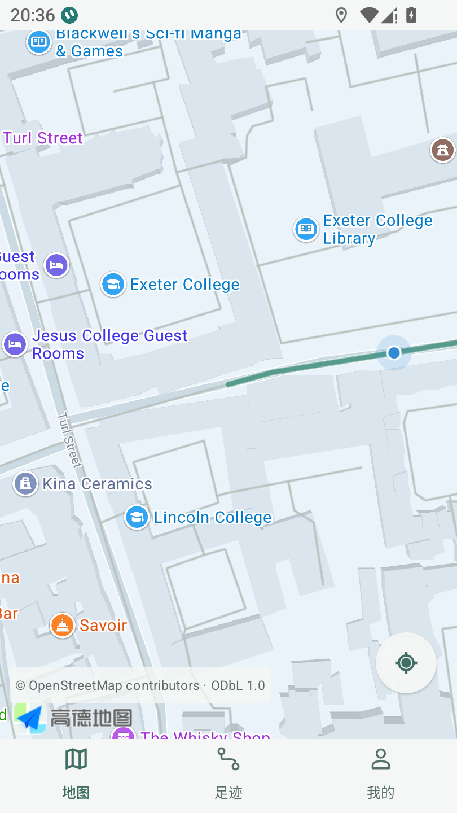
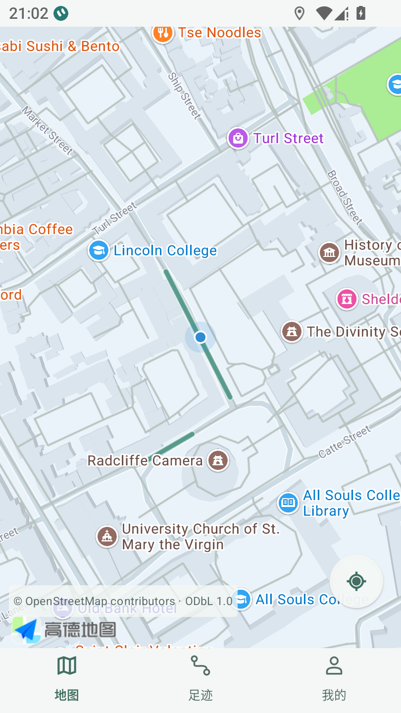
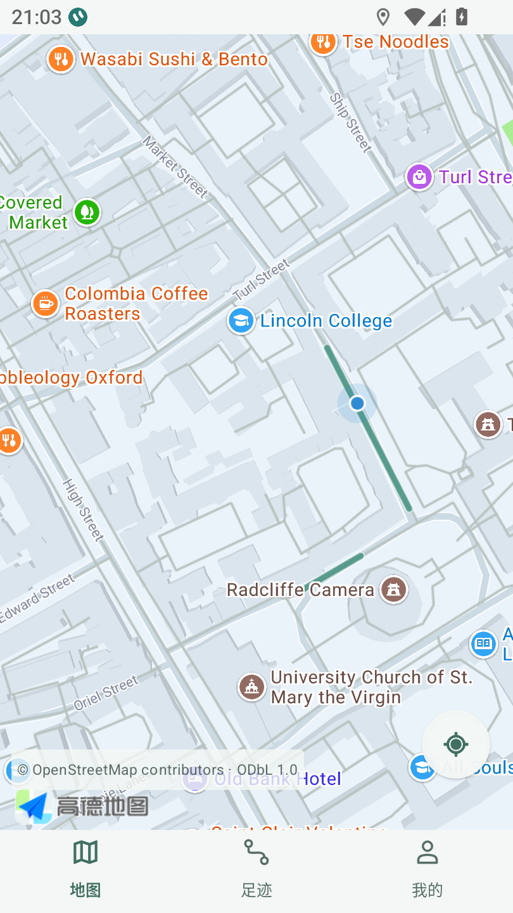
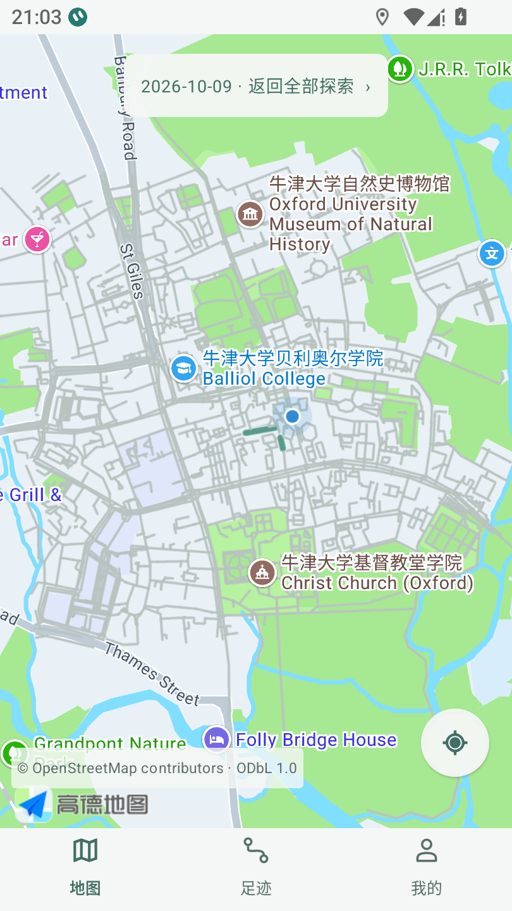
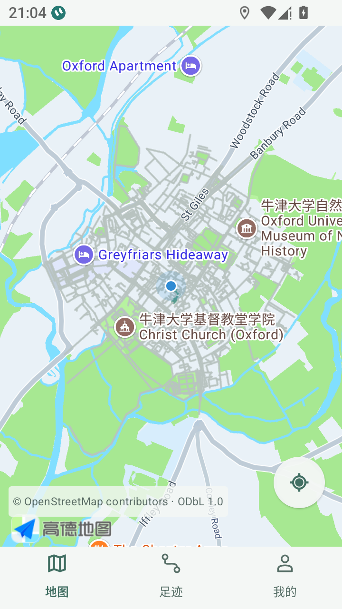
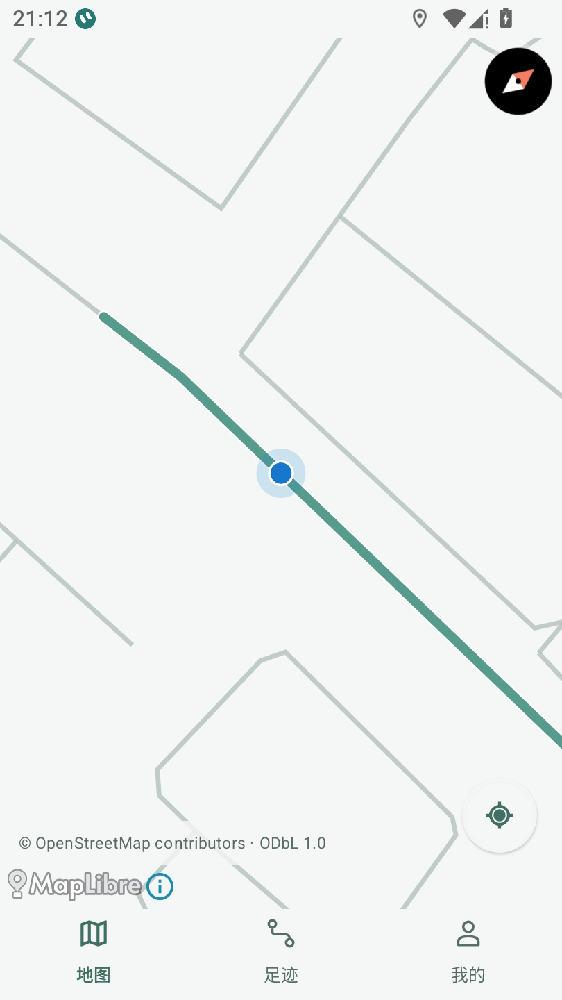

# v0.10 — 地图位置与手机朝向跟随 / Issue #7

[草稿 PR #13](https://github.com/h516df/walkpaint/pull/13)（base #9分支），不合并。GitHub Actions未配置，空checks不代表CI通过；以下均为本机或真实MuMu验收。

状态：**生产 APK 与 MuMu 真实地图交互通过，手机旋转和 P0 真机故障仍未验收。** 本次只实施 #7；以 #6 的模拟器稳定 v0.9 基线 `5c3bcee` 串行继续，#6 不关闭，#8 尚未开发。工作区 `D:\Worktrees\walkpaint-issue7-follow`，分支 `issue-7-map-follow`。没有修改 canonical checkout、#6 工作区、录制服务、数据库或道路 matcher。

业务/测试源码 `3728c18b7e5ce834048e717d2ad63e6c31cdf909`。`cn.walkpaint` / code11 / name0.10 / schema2 / arm64；沿用签名 SHA256 `21b74e3e2a10e12da8284d4e6bd7d99e55b00a385215902e94d7896f7a46c967`。本地 `WalkPaint-v0.10-arm64-debug.apk` 为 70375792 字节，SHA256 `cc510ff035a7b039828764d46b58d45179642715d92b101a2def4315956807d9`；实际安装 base.apk 指纹一致。**[私有预览版](https://github.com/h516df/walkpaint/releases/tag/v0.10) / [手机 APK](https://github.com/h516df/walkpaint/releases/download/v0.10/WalkPaint-v0.10-arm64-debug.apk) 已开放，用户手机是否安装尚未核实。** 用户本次明确确认私有上传后，已核对服务器digest/大小并实际重新下载验SHA；private=true、draft=false、prerelease=true，标签固定上述业务提交，旧v0.8保留。实读见 [发布校验](v010-publication.json)。此前自动审批要求具体确认，本次已由用户明确授权满足。

## 可观察行为

- 进入地图默认跟随新鲜可靠定位；平移和方向更新保留用户缩放。相机使用位置质量与漂移门槛，独立于原 GPS 保存及真实道路确认。
- Android rotation vector 方位角按屏幕方向换算；角度跨北向使用最短差值平滑，输出最多5Hz、抑制小抖动及突变。没有传感器或准确度不足时保持北向。仅可见且正在跟随的地图注册监听；后台、浏览与历史停止。
- 拖动、双指缩放/旋转、双击暂停自动跟随；原“定位我”恢复。按天历史保持自己的相机，退出历史恢复。未增加首页卡片或录制开关。
- 高德与 MapLibre 离线回退沿用相同状态；原道路颜色、许可署名、GPS/OSM WGS84 与高德显示边界转换保持。

## 验证

| 验证 | 结果与证据 |
| --- | --- |
| 单元测试 / 构建 / 签名 | 100 项 JVM，0失败/错误；Debug与AndroidTest构建成功，签名相同 |
| 原版失败复现 | 同一公开牛津道路位置移动后，蓝点偏移299.275px；[原始结果](v010-before.json) |
| 新版实际高德 UI | 同样移动后偏移0px；拖动暂停、定位恢复、差精度不入库/不拉相机、历史保持/退出、后台入库与返回、320dp小屏通过；原219点/全部trips与points行保留到224；[结果](v010-ui.json) |
| 实际离线 UI | 正常设置撤回高德后，MapLibre跟随偏移0.063px，浏览偏移134.49px，定位恢复；原227点保留到230，测试结束恢复高德授权及测试设置；[结果](v010-offline.json) |
| 屏幕方向 | Android实际 SensorManager：0/90/180/359度公开合成向量 × 四种屏幕方向，共16组；包含在隔离数据库 instrumentation PASS |
| 实际高德相机与监听 | 固定公开位置，0/90/180/359/1度 bearing 实读，zoom16.25保持；真实HOME/返回注销与恢复，浏览停止；trips/points/roads/road_matches/coverage全部行不变；[结果](v010-camera.json) |

实际截图均是固定公开牛津模拟位置，没有用户手机原图或私人轨迹：

| 原版移动后 | 新版移动后 |
| --- | --- |
|  |  |






## 测试失败记录与限制

原始失败保持在忽略的 verification，不回写。MuMu实例数次退出导致ADB unavailable，恢复的是同一个已有实例，未重启共享adb或改模拟器配置。方向矩阵的初始测试预期把屏幕90度换算符号写反，按Android实际remap结果修正。离线地图原判据仅看水平分量，旋转后被位置移动抵消，改用二维位移，保持原70px门槛。最初相机探针直接调用Activity回调且没有迁到MuMu主显示，出现bearing/zoom/后台监听断言失败；最后使用生产UI测试相同的主显示入口、真实HOME/返回并等待相机实读，全部通过。生产APK未为这些测试入口调整重建。

仍未验收：真实 vivo 手机原地旋转的方向准确性、360度连续观感/磁场干扰、长期耗电/Doze/厂商后台、真实中国道路偏移、#6原无GPS回调及0米根因。合成向量和模拟器 SDK bearing 不能替代真机旋转证据；#7保持开放。两指手势与双击已接入，实际自动化主要覆盖单指拖动和SDK缩放/角度实读，未把它写成已逐项手动实测。

回退：schema2兼容源码、同签名、code>=11的修复 APK 覆盖安装；不得卸载清数据、直接降旧code或降schema。PR不合并；v0.10私有分发已由用户本次明确确认并完成，不能据此关闭真机验收。

## 重跑与官方依据

仅允许已有MuMu `127.0.0.1:16384` 或 `emulator-*`；三个 UI/SDK脚本需要本机已构建的APK与AndroidTest，以及模拟器已有公开测试道路。不会给真实手机注入定位。

```text
gradlew.bat :app:testDebugUnitTest :app:assembleDebug :app:assembleDebugAndroidTest -PwalkpaintArm64Only=true --offline --console=plain --no-daemon
python scripts/android_follow_acceptance.py --apk WalkPaint-v0.10-arm64-debug.apk --version-code 11 --output verification/issue7-ui
python scripts/android_follow_offline.py --apk WalkPaint-v0.10-arm64-debug.apk --version-code 11 --output verification/issue7-offline
python scripts/android_camera_follow_probe.py --apk WalkPaint-v0.10-arm64-debug.apk --version-code 11 --output verification/issue7-camera
```

方向换算依据 [Android position sensors](https://developer.android.com/develop/sensors-and-location/sensors/sensors_position) 与 [SensorManager](https://developer.android.com/reference/android/hardware/SensorManager)；相机接口依据 [高德 AMap](https://a.amap.com/lbs/static/unzip/Android_Map_Doc/3D/com/amap/api/maps/AMap.html) 与 [CameraPosition.Builder](https://a.amap.com/lbs/static/unzip/Android_Map_Doc/3D/com/amap/api/maps/model/CameraPosition.Builder.html)，实际API也核对了当前依赖jar。测试使用 [Android Instrumentation](https://developer.android.com/reference/android/app/Instrumentation) 与系统真实Activity入口。
