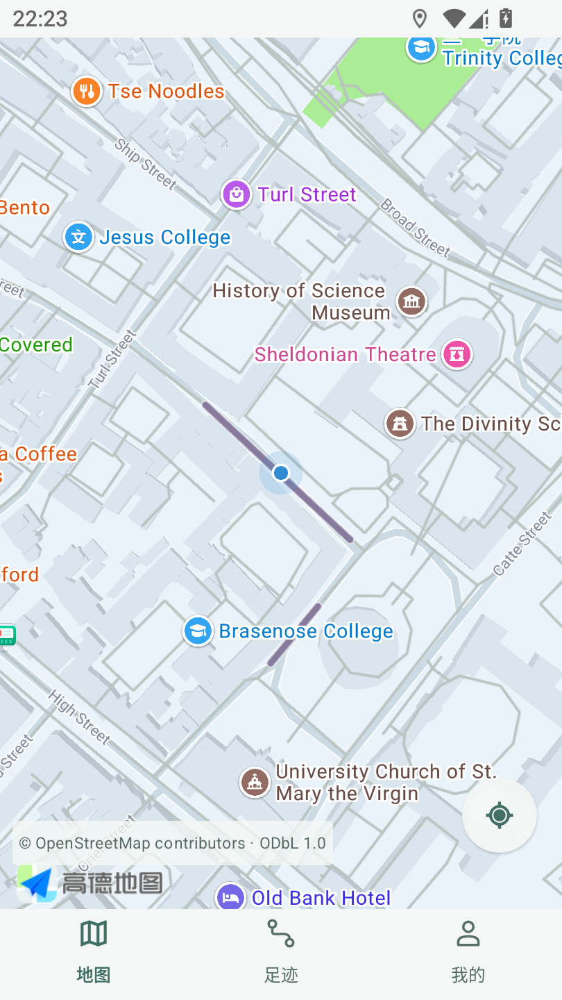
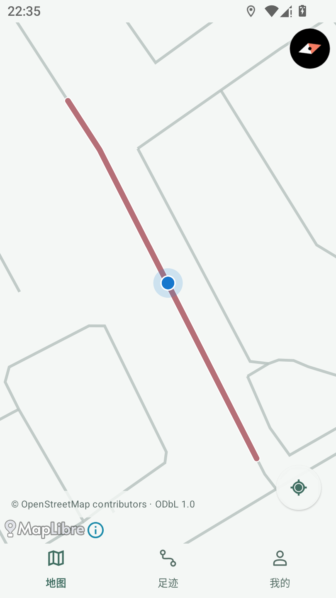
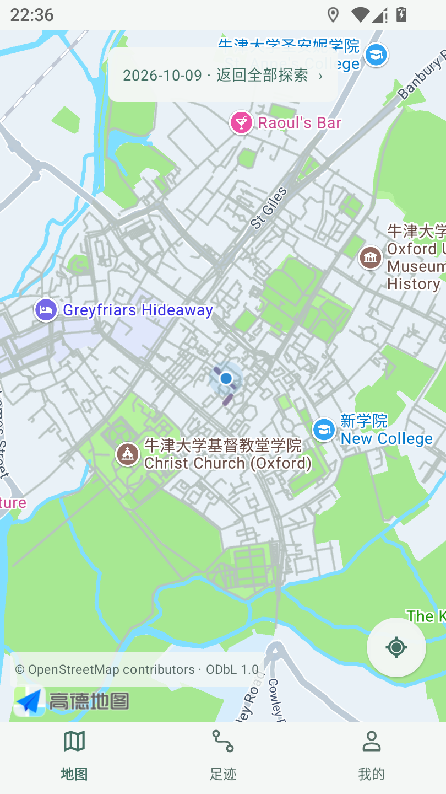
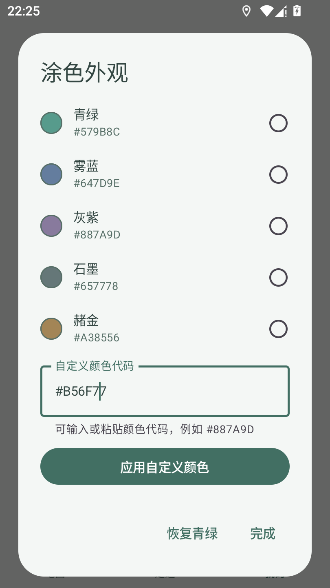
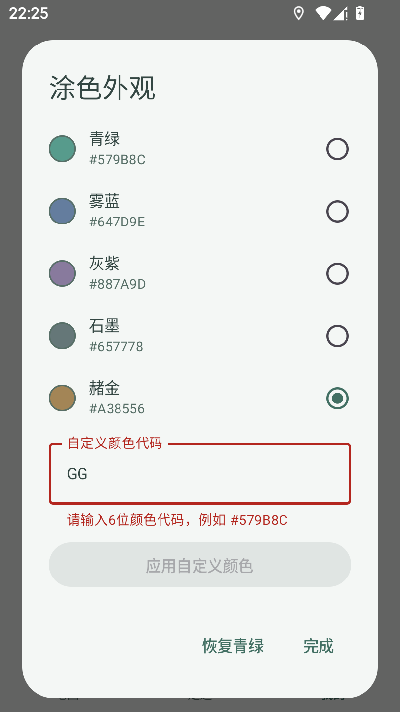
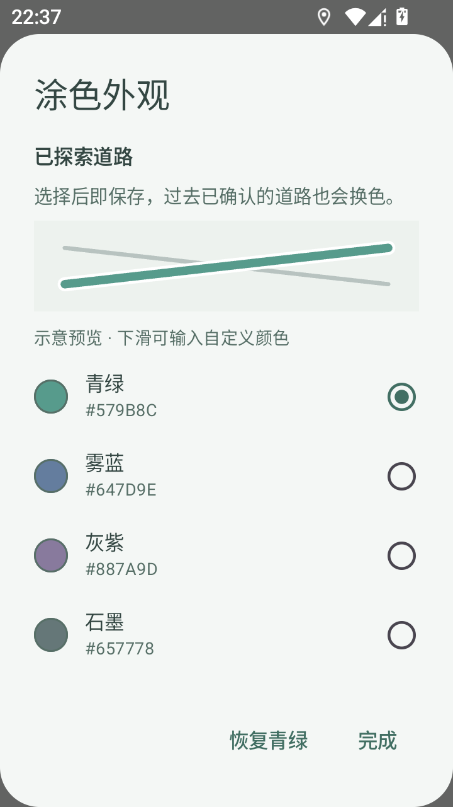
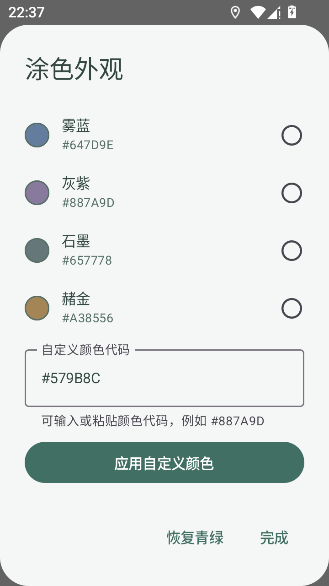

# v0.11 · 道路涂色外观验收

Issue [#8](https://github.com/h516df/walkpaint/issues/8)，以已验收 v0.10 / PR #13 的 `0a5c6ada079b327f9948115146dfc8ad3477871d` 串行开发。业务/测试源码 `d8cb3ba4ca8fc401756e040c56bd039b310ae9e5`；独立工作区 `D:\Worktrees\WalkPaint\codex-issue8-road-colors`，分支 `agent/codex/issue8-road-colors`。[草稿 PR #15](https://github.com/h516df/walkpaint/pull/15)，已推送、未合并，不合并。

**状态：本机软件与 MuMu 实际入口验收通过；用户本轮明确确认后 v0.11 私有 APK 已分发并实际下载校验，真实 vivo 视觉、方向、长期后台和 GPS P0 未验收。** 无 GitHub Actions，不能把空 checks 写成 CI 通过。图中地图仅为固定公开 Oxford 测试区域，定位来自模拟 GPS。

私有分发：[手机APK](https://github.com/h516df/walkpaint/releases/download/v0.11/WalkPaint-v0.11-arm64-debug.apk) / [发布页](https://github.com/h516df/walkpaint/releases/tag/v0.11)；[服务器与重新下载实读](v011-publication.json)。标签固定业务`d8cb3ba4ca8fc401756e040c56bd039b310ae9e5`，不移动到后续文档提交。手机是否安装未知。

## 用户可观察行为

我的 → 地图外观 → 涂色外观。青绿、雾蓝、灰紫、石墨、赭金五个预设；可输入六位颜色代码应用自定义颜色；恢复青绿。选择即刻保存到本机，旧的已确认道路随之重绘，不用重走/重匹配。仅已探索道路改变颜色，未走道路灰色、白色描边与蓝点保持。首页没有新增卡片或按钮。

高德 Polyline 与 MapLibre 图层使用同一选择；在设置来回导航保留地图相机，历史视角与跟随模式保持。RecordingService、SQLite/schema2、matcher、GPS 保存门槛、备份格式不改。外观是本机偏好，不包含在轨迹备份中。

## 产物与结果

`WalkPaint-v0.11-arm64-debug.apk`，cn.walkpaint / versionCode12 / 0.11 / schema2 / 原签名 / arm64。大小 **70,428,652** 字节；SHA256 **`ec5066db7c0424327597d1ca67105ced83cccaf82648e03f74492757fe0f5994`**。实际安装的 base.apk 指纹相同。签名证书 SHA256 `21b74e3e2a10e12da8284d4e6bd7d99e55b00a385215902e94d7896f7a46c967`。

- 103 项 JVM 零失败，生产 APK 与 Android 测试 APK 构建通过。
- 五个预设通过实际 UI 点击、截图颜色/几何检查；灰色道路和蓝点位置相同。自定义有效输入生效，无效输入显示原位错误且不可应用；重开与同版本同签名覆盖安装保留选择。
- 两个实际 SDK 各验证五预设 + 一自定义：道路颜色、缩放/角度/中心、跟随状态和全部五张数据库表保持；不是仅测颜色模型。
- 历史已确认日换色保持视角；恢复默认、自动记录开关、320dp 小屏及滚动后输入框实际操作通过。换色阶段 230→230 点，五张表逐行不变。
- 地图跟随回归：蓝点位移 0.0px；拖动暂停、定位恢复、差精度拒绝、历史视角保持、后台记录与前台恢复、小屏通过。旧行全保留，公开模拟走路新增 5 点（230→235）。
- 再次正向/反向走已覆盖道路新增 5 个定位点（235→240），覆盖长度 **109.99992743301601→109.99992743301601 米**，没有重复累计。全部测试清理无错误。

原始分段证据：[预设/UI 分段](v011-presets-partial.json)、[最终颜色专项](v011-colors-final.json)、[跟随回归](v011-follow-regression.json)、[重复走路](v011-revisit.json)、[高德 SDK](v011-AMap-sdk.txt)、[MapLibre SDK](v011-MapLibre-sdk.txt)。第一份保留其 SDK 阶段失败，不能称全轮 PASS：MuMu 移动任务到主屏会重建 Activity，测试仍引用已销毁 Activity，导致“rendering not ready”。已修正测试生命周期跟踪并在同一生产 APK 上复验剩余专项通过，未删除/改写旧失败记录。各分段合起来覆盖当前范围，未声称最终再次一口气跑完整脚本。

## 实际渲染

默认青绿与灰紫：

 

自定义颜色、离线地图与历史道路：

  

编辑与错误状态、320dp 小屏：

   

## 复验与回退边界

JDK21、SDK36、项目既有 Gradle 缓存：`gradlew.bat :app:testDebugUnitTest :app:assembleDebug :app:assembleDebugAndroidTest -PwalkpaintArm64Only=true --offline --console=plain --no-daemon`。

Android 使用项目 scripts/android_colors_acceptance.py、android_colors_remaining.py、android_follow_acceptance.py、android_color_revisit.py；仅允许 MuMu `127.0.0.1:16384` / emulator-*，使用固定公开道路模拟 GPS、保留原数据，不卸载清库。截图颜色分析需 Pillow；本机已安装在 Codex bundled Python，默认 uv Python 没有 Pillow。MuMu 在受控 shell 会话结束后可能正常关机；测试时启动与整段 adb 验收需同一存活 shell 会话，不能把它当 App 崩溃。

未测：真实 vivo 户外颜色辨识/中国道路位置、手机真实朝向、Doze/长期锁屏/耗电及原无 GPS 入库故障。#6/#7/#8保持开放，不因模拟器通过关闭。用户手机是否安装未知。回退用同签名、schema2、code>=12 的修复包覆盖，不能卸载/清数据或直接降级旧包。
