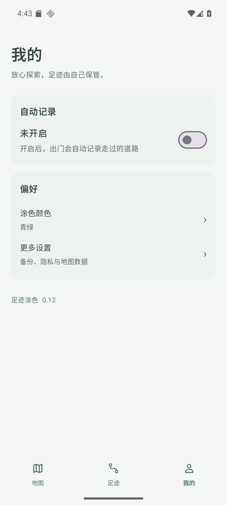
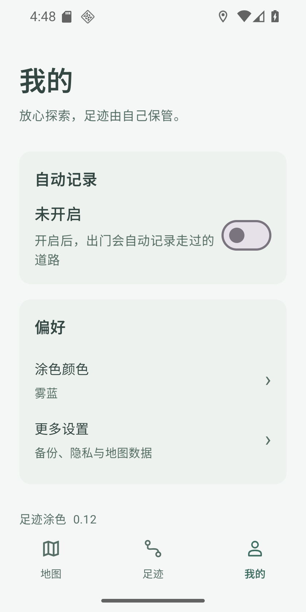
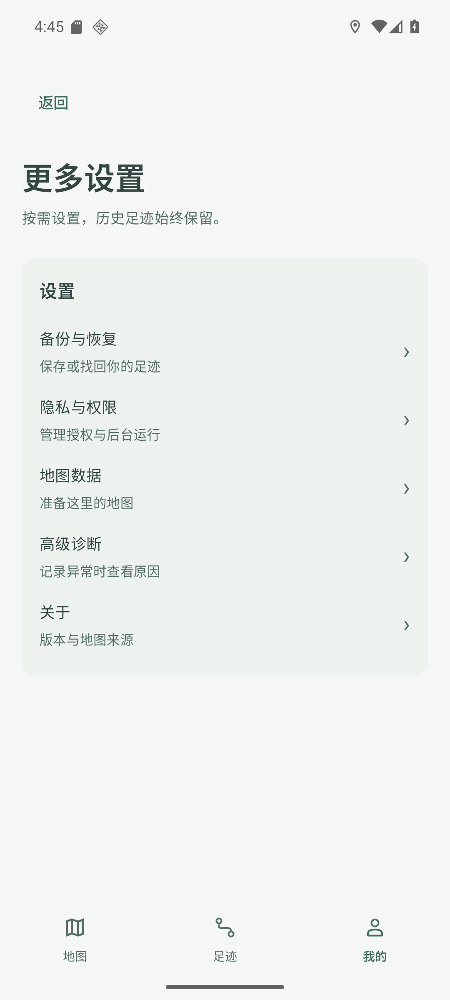

# v0.12 — Issue #12 候选验收（2026-10-10）

状态：**UI/授权/实际模拟记录通过，APK 本地就绪；未发布、未合并、vivo 未验收。** 业务/构建源码 `92a22262cd2283b35c5b54330b3e2d8b68d164ff`，基线 v0.11 / PR #15 `3f9604d034cf230021a566b40f0fb1acacc47420`。专用 Google API36 x86_64 AVD，未操作 MuMu/手机。

## 本阶段范围

- 一级“我的”保留一个自动记录开关、涂色颜色、更多设置和当前版本；专业设置进入备份与恢复、隐私与权限、地图数据、高级诊断、关于。#10 反馈/#11 更新尚未开发，不放假按钮。
- 用户主动开关触发引导；精确定位 → 独立后台位置设置 → 按版本请求通知 → 启动原前台服务。已有授权不重复请求；拒绝/稍后/从系统设置返回准确处理，状态随真实权限/记录诊断显示。
- 缺地图数据时显示可暂不的轻提示，切 Tab 后不重复催促；准备地图沿用原区域/IP告知与本次同意，取消未下载。
- 未修改 RecordingService、SQLite/schema2、GPS/道路匹配阈值、备份格式或地图 SDK。#6 真机根因仍未知，本阶段不宣称修好。

## 实际验证

- 111 项 JVM、7 项 Google 设备保护测试通过；Gradle 单元测试、通用 APK/AndroidTest、手机 arm64 APK 构建通过，原签名验证通过。
- 实际安装通用包 SHA256 与本地一致；手机包与通用包全部 dex 一致。手机 `cn.walkpaint` / code13 / 0.12 / arm64-v8a / 原签名 / schema2。
- 实际 UI：一级界面没有 GPS/OSM/附近道路/权限大段文字；拒绝定位保持关闭；系统精确位置/后台位置/通知授权与返回串行继续；已有授权重开无重复提示。
- 虚拟 GPS 经原服务真实入库：前台、切后台、短时关屏 **1→4 点**。关闭后不再新增；原测试记录逐行保留。此处只证明专用模拟器，不代表 vivo 室外或长期锁屏。
- 二级备份/隐私/诊断/地图数据/关于真实入口通过；颜色入口选雾蓝成功；320dp 截图检查无明显溢出；后台授权暂不时显示“需要允许后台定位”，不死循环。
- 首次确认/取消/一次系统权限请求专项通过，过程未改数据库；恢复原 onboarding。地图缺数据提示与 Tab 关闭状态、下载前披露及取消专项通过。
- Android 隔离数据库 suite PASS（旧迁移、GPS/道路事务、去重等既有边界）；Google 最初 v0.11 数据库为空，后续重复覆盖测试保留已有 1 个模拟点。**不是用户手机旧库验收**。

手机 APK：70,188,579 字节，SHA256 `de5963bf3dcbdce1af4d051cc116d5aa20b2a0e283f2f865b2351239a7bae3d2`。通用/已安装包 SHA256 `1fb41afc85bc389efc68cfc1188b2f7aff868e0bc01fe4261b463c1bbff310e6`。完整指标见 [v012-acceptance.json](v012-acceptance.json)。

## 失败、修正与限制

测试曾因 Compose 开关 class/系统弯引号/遗留权限窗/自定义颜色字段在滚动区外而失败；按真实 XML 调整选择器/测试清理，原失败 JSON 保留在 ignored verification。核心路径已通过，颜色/小屏/背景暂不用同一已安装 APK 做针对性续验，未把原失败改写成一次全流程 PASS。

Google AVD 上更换已订阅 test provider 的初版测试没有按预期递送位移；回到官方文档改用 `adb emu geo fix` 虚拟硬件，在当前模拟位置附近移动并保持原跳跃拒绝，真实入库通过。没有为测试放宽业务算法。恢复虚拟位置、权限/拒绝标志、偏好、app-op、尺寸/密度、临时文件；主验收 cleanup_errors=[]，两个专项原偏好核对恢复。

**本机 Google AVD 的高德地图区域在旧 v0.11 基线也为黑色**（原 before.png/before-profile.png 留在本地 work）。本阶段只认可页面、地图提示/独立同意和记录路径；没有宣称 Google 底图或彩色道路像素回归通过。单列后续任务，不能用历史 MuMu 证据替代。原用户 vivo 高德底图曾可显示，v0.12 的 vivo UI、真实道路、朝向、长期后台与耗电仍未测试。仓库无 GitHub Actions，CI 不称通过。

官方边界：[前台位置请求](https://developer.android.com/develop/sensors-and-location/location/permissions/runtime)、[后台位置](https://developer.android.com/develop/sensors-and-location/location/permissions/background)、[模拟器 geo fix](https://developer.android.com/studio/run/emulator-console)。Android 11+ 后台“始终允许”须用户在系统设置操作，App不能代授。

## 回退与接续

只在任务 worktree 写入，未改 canonical/#6/#7/#8/QA 分支，未合并 PR；从内容一致的 QA 缓存恢复后，将业务提交父节点对齐到已核验的 PR #15，树内容一致。回退从 v0.11 源码构建 **同签名、schema2、code>=13** 修复覆盖包；不得卸载、清库或直接装低 code。用户确认具体 v0.12 私有预览分发后才上传/建 Release，随后校验服务端和重新下载 SHA。无假下载链接。
