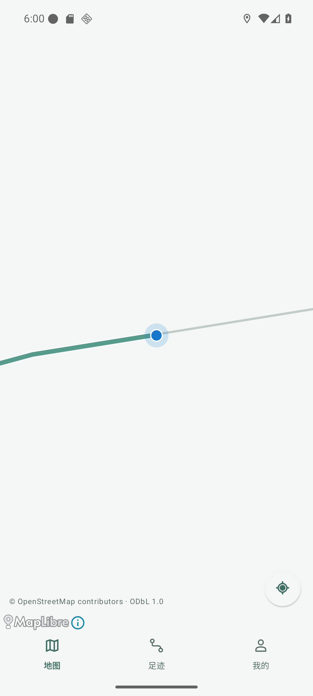
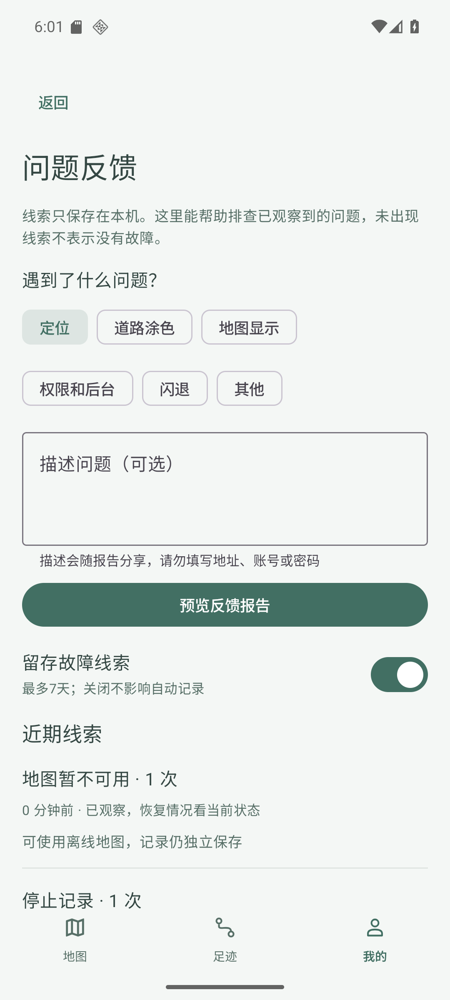
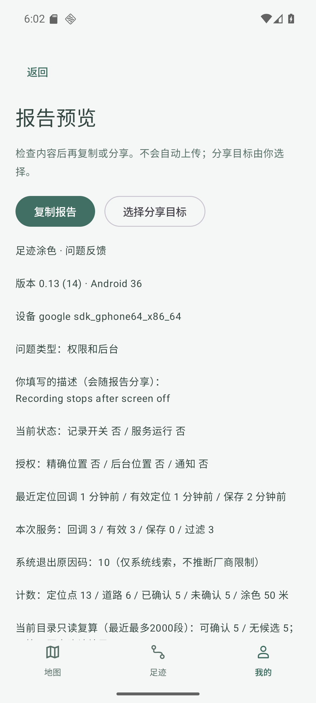
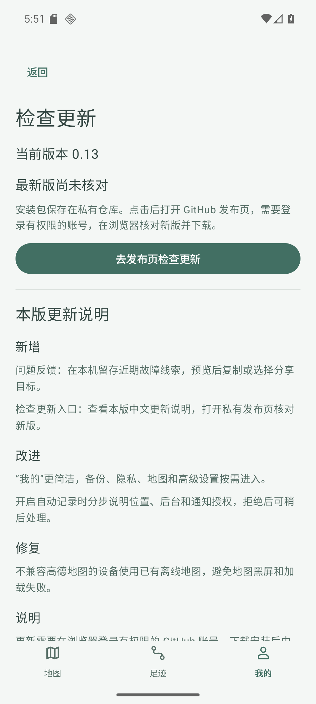
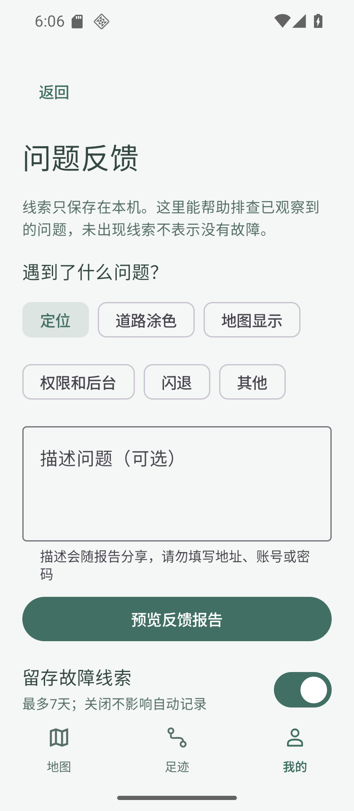

# v0.13 整合验收 · 2026-10-10

业务源码 `f6f4514a8b615568e19cb31e054ced443f592e23`，串行继承 PR #16 `c7bba2c`；独立工作区 `agent/codex/issue11-updates`，未从过期 main 重做。地图兼容 `82cc1c2`、反馈 `3857616`、更新 `6eb06ab`、取消反馈修正 `f6f4514`。最终同签名包为 cn.walkpaint / code14 / 0.13 / schema2。PR 未合并、CI未配置，手机未安装。

## 范围与结果

- #12 简化我的/按序授权继承；#10 本地反馈、预览/复制/系统分享选择器、独立清空/关闭；#11 当前中文说明和私有浏览器检查入口；#17 ARM地图库兼容守卫，x86使用已有离线地图。
- 127 JVM + 7 Google设备守卫通过。只认 emulator-5556 / WalkPaint_Google_API36 / Google API36 x86_64；没有操作个人MuMu/手机。
- 最终通用APK实际安装指纹一致，反馈填写/分类/报告预览/复制/系统选择器、清空后五表不变、关闭后重启保持设置通过。分享未选择联系人或发送。
- v0.12→v0.13同签名覆盖安装，旧五表行保留；当前说明、浏览器实际目标与返回后仍未知最新版通过。不登录私有账号、不声称已取到新版/完成App内下载。
- 通过应用系统文件选择器导入固定公开Oxford道路。虚拟硬件GPS实际记录6点，前台/退后台/短时锁屏产生连续写入，约50.04米道路确认；真实截图检测7508个青绿色道路像素。MapLibre实际SDK六色/相机/跟随保持探针PASS，原点保留。
- 白名单报告忽略任意坐标/URL/道路名编号/原始日志等字段，用户描述明确可见并限制1000字；事件只有固定原因+时间+次数，最多7天/500条/256KB，重复按5分钟合并。普通事件沿用原30秒写入线程与调度，关键线索即时保存，不增定位/监控服务或遥测。
- 用户主动取消地图下载不记成故障；原录制服务、GPS/道路阈值、SQLite结构/轨迹/覆盖/备份格式未改。

- 最终包隔离库/迁移/失败回归通过，生产五表完全不变；320dp我的与反馈实际渲染/按钮边界通过，视口恢复实读一致。

## 真实失败与修正

最初地图兼容守卫失败测试为未实现AmapPlatform，后通过。高德黑屏根因由应用UnsatisfiedLinkError、GLMapEngine调用栈及APK的ARM库/x86进程证实，[官方文档](https://lbs.amap.com/api/android-sdk/guide/create-project/android-studio-create-project)说明10+仅支持ARM。两种GPU后端不能补足缺失ABI。改为守卫后JNI错误归零，真实离线道路和彩路通过；ARM高德本轮无法在Google x86运行，未冒充通过。

首次道路测试误用过大步长；连续测试仍受旧合成城市与Oxford之间跨城跳点拒绝，固定JUMP_OR_TOO_FAST/距离证据已定位。没有清库、改时间或放宽阈值，保持服务关闭等正常25分钟新行程边界后，先设公开GPS再启服务，最终通过。旧合成行全部保留。

反馈提示单测曾发现“当前可确认但未涂色”的提示优先级缺陷，修正并全测通过。真实截图发现预览沿用表单滚动位置，改为切换预览时重置列表位置并复验。首次关闭留存UI测试错选FilterChip，补明确无障碍标识/正确选择器后全链重跑通过。浏览器首次启动引导曾使地址断言失败，专用AVD选择无账号模式后真实目标通过；没有私有认证验收。

## 产物与回退

手机arm64：70238534字节，SHA256 `0d803b4b060807bb7512b90cfc683fd341604ce3f88ccd2b713709e6738804a9`。
Google通用：125160426字节，SHA256 `8fd4d1953ca3ade199ec0de4f0d089de4566bb8d408638c78d67bc7e08f08c71`；二包全部dex与内置release-notes.json一致。原证书SHA256 `21b74e3e2a10e12da8284d4e6bd7d99e55b00a385215902e94d7896f7a46c967`。

中文说明唯一来源为 app/src/main/assets/release-notes.json，APK提取同字节文件作为分发说明。当前[原始验收摘要](v013/acceptance.json)和截图只含公开合成测试数据、非唯一型号与安全计数，不含私人轨迹或秘密。

真机vivo户外/中国道路/朝向/长期后台与耗电未验收，#6/#7/#8/#12保持开放。#11仅达到既定浏览器降级MVP，完整自动更新依赖后续授权渠道；不加认证凭据、服务器或公开资产。不能把模拟器短时成功等同手机原故障已修复。

回退从schema2兼容源码构建原签名code>=14覆盖修复包；不卸载、不清库、不能直接安装旧低版本或schema1。

