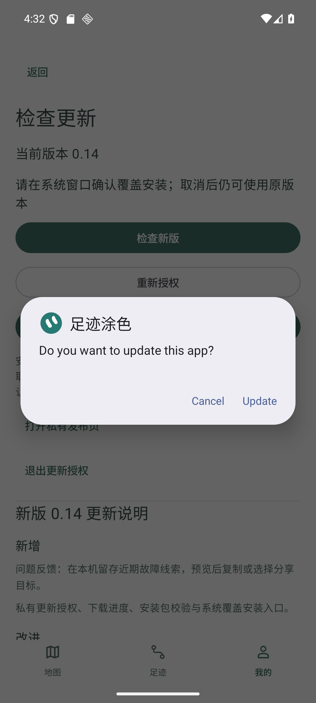
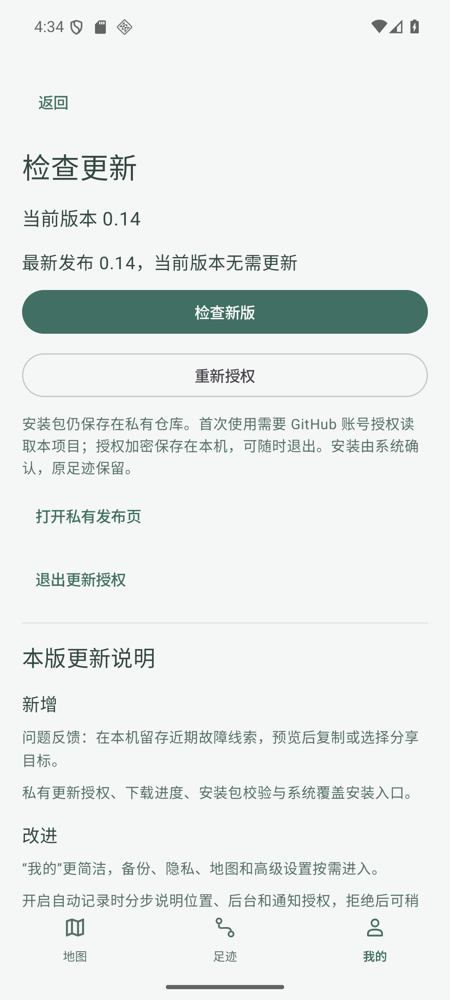
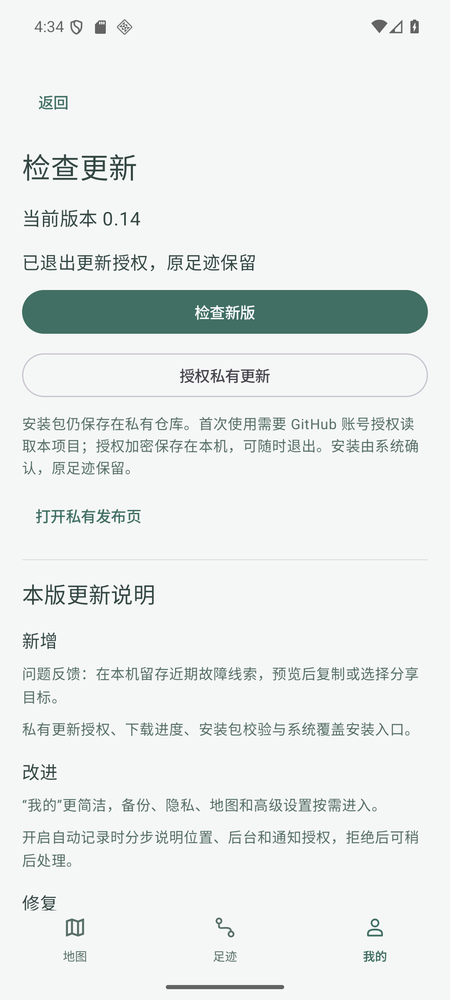

# v0.14 私有更新交付 / #11

当前业务与安装包源提交 `bcec979015593e67f8ae3567bcbce4bfec0f5f9b`，分支 `agent/codex/issue11-private-updater`，工作区 `<work-dir>\worktrees\WalkPaint\codex-issue11-private-updater`，继承 #20 / ed6ee80；[草稿 PR #21](https://github.com/h516df/walkpaint/pull/21)，未合并。

## 已验证

- 171 JVM 与 7 Google guard；实际 Android Keystore 独立命名空间往返、随机 IV、篡改失败清除、退出；原包解析/实际签名与 ABI；同版本、坏包拒绝；FileProvider 仅 updates 子目录。
- 用户明确同意仅 walkpaint 只读。GitHub App 属于 h516df，id 5257963 / installation 169794251，仅选 repository 1410040906；Contents 和 Metadata read；device flow 已开，无 webhook/server/client secret/private key，不复制 PC gh 凭据。公开 client id 属于非秘密配置。
- Google 专用 AVD 上实际设备授权与私有 manifest/hash 核对、重开复用本机授权通过；当前已发布 0.13 与本地引导 0.14/code15 准确区分，全部五张表原行不变。
- code15 仅为本地授权引导，未分发。最终 code16 新包在尚未更新的真实 code15 上经过 PackageManager、hash、原签名/包名/版本码/ABI/minSdk 校验通过，未把这个预校验称为安装。
- 最终 arm64 与 universal 的所有 dex 和内置说明字节相同，包名 cn.walkpaint、schema2、原证书 `21b74e3e2a10e12da8284d4e6bd7d99e55b00a385215902e94d7896f7a46c967`。arm64 70288352 字节 / `04985a845d7cd882995097bd106823e6ec052ccde2ee79b4a76ab0d8b0bfddf2`；universal 124880891 字节 / `f2ba1250fe50690b599f1cb286a62427cf923eb0432399e8b3ee3f5e09e8e0f4`。

## 最终实际下载与安装

用户之后明确回复“确认”，允许开放 v0.14 私有预览。按原 `gh release edit --draft=false` 成功，实读 private=true/draft=false/prerelease=true，标签源 bcec979；4 个服务器资产大小/digest 与本地一致，发布后实际重新下载手机包 SHA 一致，详见 [publication.json](v014/publication.json)。原 v0.13 资产保留。

仅在 emulator-5556 / WalkPaint_Google_API36、同签名本地 code15 上实际走私有更新链路：发现 code16、显示中文说明、实际下载取消并清 partial、重新下载、完整 SHA 与 Archive 校验、拒绝来源权限、取消系统安装，旧版与原五表保持；再次由系统确认覆盖后，实装 code16 的 APK SHA 为最终 universal f2ba1250…，全部旧行逐一保持。安装后重开继续使用原授权，真实读取已发布0.14，显示无需更新，再退出更新授权；[实际链路结果](v014/acceptance.json)。

第一轮在覆盖完成、安装 SHA/旧行已通过后，系统保留“App installed. / Done / Open”窗口，测试直接导航“我的”失败。保留 `verification/private-update-e2e/acceptance-first-navigation-failure.json` 和失败截图；脚本补 Done 处理，以同一已装最终包做受守卫的分段续验，真实新版核对/退出通过。没有降级、卸载、清数据或重做整轮。code15 为本地引导测试包未分发，名称与最终16均为0.14，因此发现新版本截图的旧/新名称相同；正常0.13手机升级显示0.13→0.14。

最终 code16 上再次执行 Android crypto/package/provider 边界测试通过：[final Android boundaries](v014/android-boundaries-final.json)。生产 APK 未因测试修正重建/替换。退出后的专门只读探针在 App 进程内验证授权偏好为空、AndroidKeyStore alias 删除、cache为空，仅导出固定成功标记，没有读取/导出任何真实凭据到主机。原行 hash 再次匹配，录制关闭/无 foreground service，安装来源 AppOp 已恢复，专用 AVD 已停止：[cleanup.json](v014/cleanup.json)。

## 当前边界

本轮应用内更新软件闭环通过；手机尚未安装/验收，vivo 户外/长期后台/ARM 高德仍未验收，8小时后实际刷新令牌尚未经历（解析与故障单测通过）。没有 CI。原服务、数据库和 matcher 阈值未改；其他 worktree、私人 MuMu、手机未动；不关闭 #6/#7/#8/#10/#11/#12/#17、不合并。GitHub App 仅本项目只读的安装保持用于后续手机；本次模拟器本机授权已清除。

## 失败与修正

早期小屏测试两次因 Android 密度重建/恢复二级页导致导航假设失败；改为逐步读取实际页面再导航，同一包重跑入口/320dp/原行保留通过，保留原失败 JSON。首次真实授权后目录为空，是旧发布说明实际名为 WalkPaint-v0.13-release-notes.json，解析仅接受 release-notes.json；补精确前缀兼容与重复/错版本拒绝回归，再实际私有读取成功，未改旧资产。Windows Git schannel 推送连接被截断，未推送提交导致 Release 创建 422；改为单命令 OpenSSL/HTTP1.1 且保留 TLS 验证，推送和服务器 SHA 核对通过后重新创建 draft。

回退：同签名/schema2/code>=16 修复包覆盖，不卸载/清数据。[私有预览](https://github.com/h516df/walkpaint/releases/tag/v0.14) / [手机 arm64 APK](https://github.com/h516df/walkpaint/releases/download/v0.14/WalkPaint-v0.14-arm64-debug.apk)。
