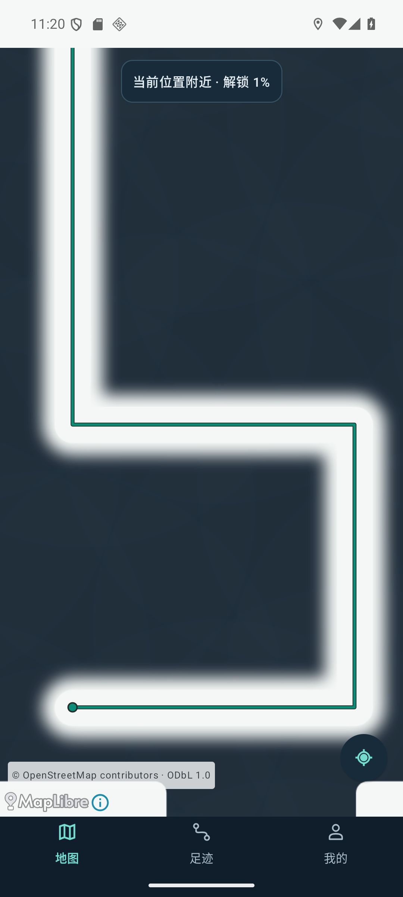
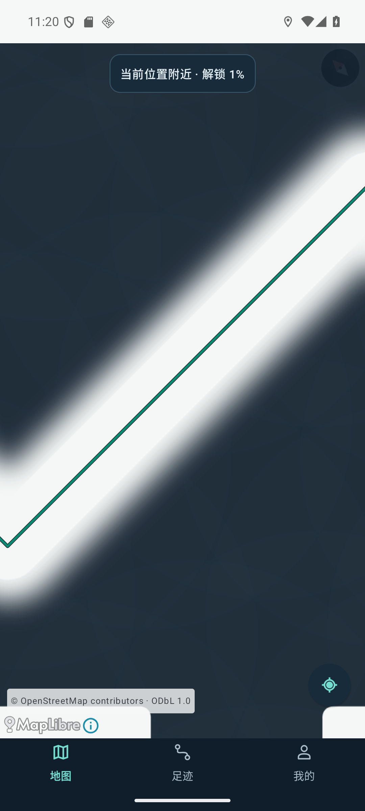
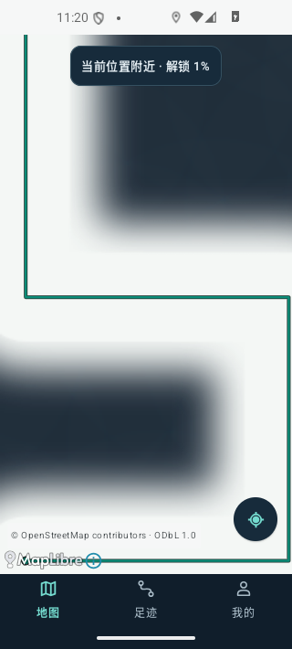

# v0.32 迷雾首版候选（未发布）

业务提交 `beacf97b2c9a6d2cf42b9a1eb6828e77c64f7203`，基线 v0.31 / `3d453aa0f54adae31513265ce8838cfcfab87fbb`。唯一写手目录 `D:\Worktrees\WalkPaint\codex-fog-of-war`，分支 `agent/codex/fog-of-war`。DSH 工作区、canonical、main 和历史发布均未修改。

用户明确反馈 v0.31 方块效果更差，要求《英雄联盟》战争迷雾的气质并让 Codex 接手。范围是显示层：深蓝灰雾覆盖整个视口，连续的已保存轨迹揭出约45米半径通道，18米软边，去除网格染色与无用网格显示计算；地图提示条/导航统一深色。显示几何沿用 RecordedTrail 断档/分段/坏点规则。数据库、录制过滤、网络目的地和已有更新授权机制没有变化。

## 已验收

- 285 JVM / 7 Google AVD 守卫通过；native Canvas 像素验证核心透明、外部深雾、软边、重复路径完全相同、空数据重置、不跨断档、相机投影移动。
- 实际 universal APK 在只读 Google AVD 副本 emulator-5556 / WalkPaint_Google_API36 / API36 覆盖安装， installed SHA 与候选一致。安装前原五表逐行相同：{'trips': 4, 'points': 137, 'roads': 0, 'road_matches': 133, 'coverage': 0}。后续仅添加固定公开巴黎夹具，不删除任何原行。
- MapLibre 真实离线界面/单指拖动/缩放/旋转及320dp地图、足迹、我的导航通过；截图为最终业务提交。**截图是离线足迹底板与公开人工路线，未加载街道底图，不代表高德或联网地图效果已验收。**
- 候选 cn.walkpaint / 0.32 / code34 / schema2。两包 dex/说明完全一致；原签名证书 SHA256 `21b74e3e2a10e12da8284d4e6bd7d99e55b00a385215902e94d7896f7a46c967` 与 v0.31 相同。arm64只含arm64-v8a；universal含模拟器CPU。
- native 第一轮重复边缘叠加失败，已去重投影线段后通过，失败记录留在本地 `native-pixels-attempt1.txt`。旧 DirectTrailProbe 在旧版接口失败，不拿它作本轮通过依据；自动录制新增导致一次等式比较失败，后以停止App后逐行比较复验。失败与通过边界不混淆。

| 候选 | 字节 | SHA256 |
|---|---:|---|
| universal | 124979119 | `67111d8589d2eb8dc6d7057e51f74eaac7d8be98511416acf67ac393969d15ec` |
| arm64 | 70370196 | `f3ab905cca998bc1c62316275634ed34da1a8770e6ea9a885c312d0ee69781f8` |

## 限制与下一步

OpenFreeMap 同意联网并记住的测试操作被自动审批审核拦截，要求明确授权区域/IP/请求的外传及持久同意；未执行，也没有更换渠道绕过。已向用户询问是否只在可丢弃的 Google 副本授权固定公开测试区域，尚待答复。高德 ARM 实际渲染、vivo 安装及户外长期后台未测，不能称手机已更新或真机可用。

本轮仍是可运行候选，未合并、未发布 Release，私人 v0.31 可继续使用。已有检查更新客户端仍选 `-debug.apk` 旧名称；正式发布时必须按现行 android-update-kit 发布规则处理标准名称，并兼容已安装 v0.31 的旧资产选择，不能只上传新版名称让旧客户端找不到包。不要因本轮视觉任务替换认证体系。

首页百分比仍是 PlaceProgress 约550米网格口径，与揭雾面积不一致；后续收口已有 #27。密钥保障/文档基线/真机记录分别留在 #24/#25/#6，不擅自关闭。

回退从 v0.31 兼容源码构建同签名 schema2 且 code>=34 的修复包覆盖，不卸载、清数据或降级。最新 HANDOFF 以本轮首节为准，历史文档中的版本限制只代表历史时点。

本地详细证据：`verification/fog-v032/final-report.json`，图片见下方。host脚本可通过 dedicated Google guard 复验，禁止 MuMu/手机；本轮使用只读副本，测试后关闭副本。联网授权步骤不在脚本中。

