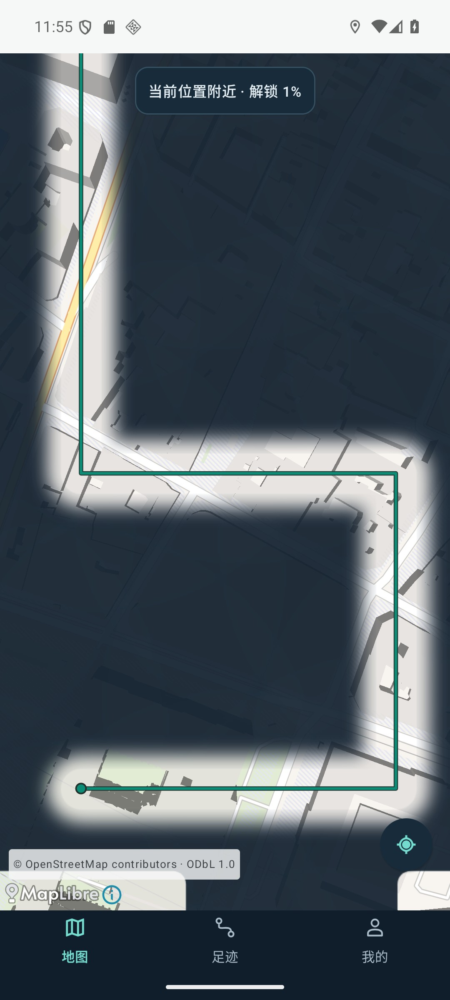
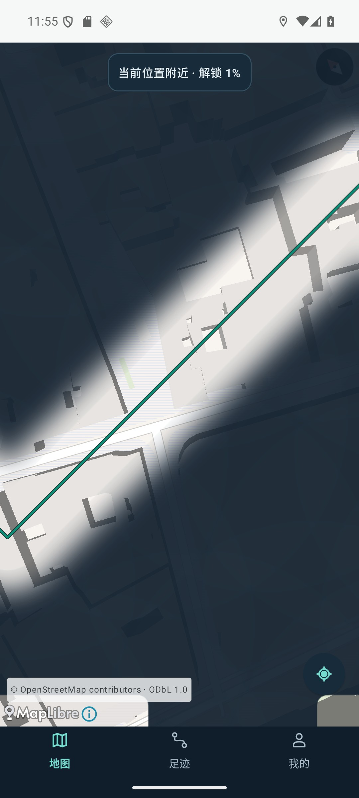

# v0.32 私有预览已开放（2026-10-11）

用户回复“同意，别乱拦截，做好我去更新了就”，明确同意此前所列的专用Google副本OpenFreeMap联网验收，并要求完成后提供现有私人更新。先前拦截已因具体用户授权解除，未修改审批策略。

[私有发布](https://github.com/h516df/walkpaint/releases/tag/v0.32)，tag固定业务/签名构建提交 `465c13668da37e1d0c3a1b5c80c2c3743be5c5d2`。仓库private，draft=false/prerelease=true；PR#33仍草稿，未合并main或DSH分支。手机版本0.32/code34/cn.walkpaint/schema2，原证书，正式release构建，未开启debuggable。

## 验收

- 285 JVM/7设备守卫保持通过。签名release universal实际安装、native像素和公开巴黎联网地图/拖动/缩放/旋转通过。升级前后、UI操作后五表行摘要完全相同：5 trips、130 points、0 roads、125 road_matches、0 coverage。无用户真实设备/账号操作。
- 最终release通用与手机包dex及内置更新说明完全相同。通用实际安装SHA `5d7708ca82522f0128f2b5775e22dd803f98d15b567f34458c00a3416d9e839a`。
- 手机包65904183字节，SHA `eecdc275b1183252fb28eb2837bef32c1145c65c9ad9adf05f06ed8750dc5889`，只含arm64-v8a；证书SHA256 `21b74e3e2a10e12da8284d4e6bd7d99e55b00a385215902e94d7896f7a46c967` 与v0.31一致。
- 使用h516df/android-update-kit `3cf277b`的发布脚本作现有项目适配，不重复安装第二套认证/更新系统。标准arm64.apk、release-notes.json、SHA256.txt符合现行规则；另附与标准包逐字节相同的arm64-debug.apk以兼容已装v0.31客户端名称。4服务器资产size/digest逐一匹配，草稿实际重新下载手机包SHA一致，开放下载后再次云读资产和固定tag。
- 客户端列举全部非draft发布并按versionCode挑最新版，pre-release可见；0.32/code34有唯一旧名arm64匹配。手机本人账户授权、下载及系统安装仍由用户执行，不能说用户手机已更新。

网络测试初轮“所有旧表必须原样包含”在导入夹具后失败；现有importBackup会重建派生road_matches/coverage，GPS/trips/roads原行保留。后续稳定夹具与正式包升级全部五表摘要一致，不能混淆升级与夹具重算。签名正式包禁止run-as；截图由同签名测试程序只传公开JPEG、无降低调试限制，原截图传输失败记录作为测试工具问题保留。

高德初次地图加载新增刷新迷雾投影回调，避免初始化时投影为空后仍留全雾。**高德ARM实际画面、vivo覆盖安装和长期户外后台尚未验收。** 未用个人MuMu，也未将Google截图说成高德或真人路线。旧v0.31保持。回退需同签名schema2/code>=34兼容包覆盖，不卸载/清数据/降级。

本地完整验收：verification/fog-v032-release/acceptance.json、publication.json。历史V032_FOG.md保留首个离线候选时点，当前以本文及HANDOFF首节为准。

