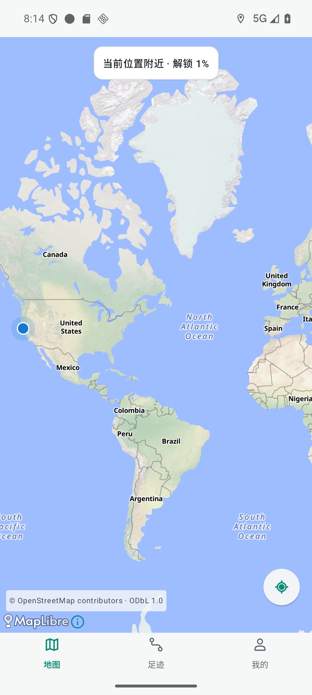
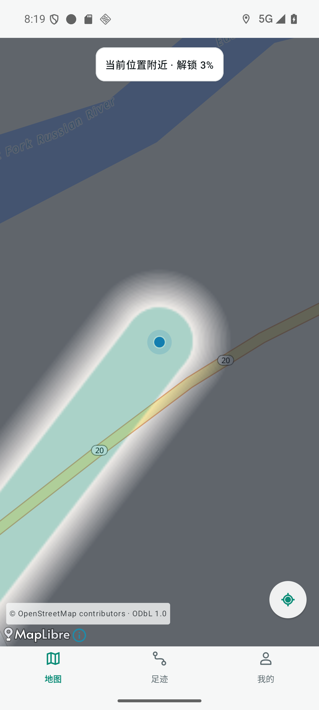
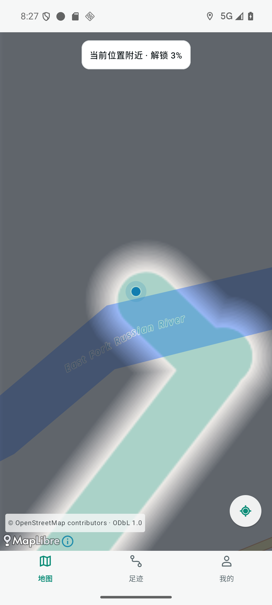
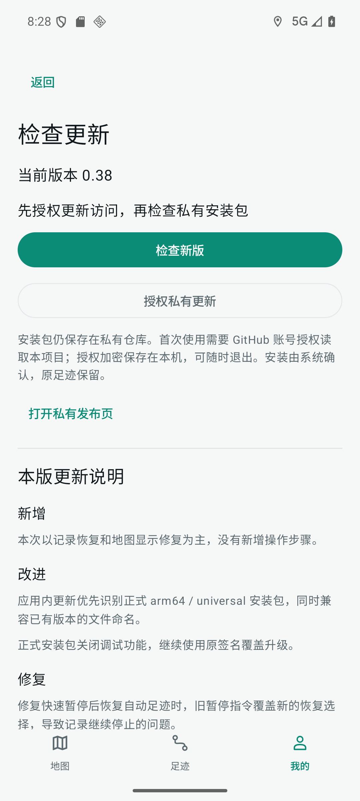

# v0.38 验收与交付证据

源码基线 5059f979857afedfe206accdea263cf18322e18f；交付代码是 v0.38 标签固定的提交。仅本轮独立分支改动，原 DSH 脏文件未触碰。无 GitHub Actions，本轮报告是本机测试，不称 CI 通过。

## 实际环境

专用 emulator-5556 / WalkPaint_Google_API36，Android 36 / x86_64，MapLibre + OpenFreeMap 联网备用地图，原有联网同意与精确/后台定位授权已启用。使用模拟 GPS、已有公开地点测试历史；无道路包，直接根据 GPS 绘制。临时只读 AVD 副本保留原 userdata。所有数据库快照仅在 Git 忽略目录，无私人轨迹或凭据上传。高德 ARM 和 vivo 手机不是本次环境。

## 失败复现与修复

- 真实服务同一个 UI 事件内暂停再恢复：基线返回 `queued STOP overwrote the newer resume choice`；修复后 debug 和最终非调试 release 返回 RECORDING_RECOVERY_PASS，GPS 注册存在。
- 原生 Bitmap 测试在基线右边、下边 alpha 未渐隐而失败；修复四边渐变原点后 FOG_PIXEL_PROBE_PASS。重复绘制测试改为检查本次返回的图，避免双缓冲旧图导致假通过。
- “定位我”曾先调用历史范围并暂停跟随，真实截图停在世界视野。修复该入口后街道视野和连续涂色实际可见。该问题通过真实 UI 复现与截图复验，没有用源码默认值替代。
- 正式文件命名的 4 项更新目录测试在旧代码有 3 项失败，修复后全部通过，保留历史命名。

## 自动测试及真实路径

- 292 JVM，0 failure / 0 error；7 Google AVD guard 测试。debug / androidTest / release 构建及 release vital lint 通过。
- 前台模拟步行 12 次输入保存8点、后台6次保存3点、屏幕关闭6次保存4点。GPS 过滤沿用现有规则，不保证每次输入都保存。整个链路通过系统 GPS 回调、原 SQLite 保存和真实地图显示。
- 本阶段五张表原行包含比较为 true；原最初4991点一直保留。最终一次调试路径5007→5022点，地图有多个不同交付修订；实际截图看到了连续带子，不以修订数单独宣布渲染通过。
- 最终非调试 release 覆盖安装前后五表逐行 SHA256 摘要完全一致（5023点）；随后正式包模拟转弯记录新增5点，并在实际画面形成弯曲连续带子。
- 正式包原生迷雾、真实服务恢复、Keystore 加密/篡改/退出清理、真实包签名/架构、同版本和损坏包拒绝、狭窄 FileProvider 通过。我的 → 检查更新显示0.38及同源中文说明；未授权点检查新版提示先授权，未冒报最新版。

## 包与发布

包名 cn.walkpaint；0.38/code40/schema2；原签名 SHA256 `21b74e3e2a10e12da8284d4e6bd7d99e55b00a385215902e94d7896f7a46c967`，aapt 确认正式包不可调试。通用包和 ARM64 包所有 DEX 与内置 release-notes.json 逐字节一致，内置说明与发布说明文件同源。

发布脚本源自 h516df/android-update-kit，适配现有目录：正式 arm64/universal APK，加相同字节的历史 -debug 文件名别名，让 v0.37 更新器能找到新版。别名中的 debug 是历史文件名，APK 本身不可调试。发布含中文说明与 SHA256 清单；绑定精确提交和远端 tag，私有仓库 gate、上传草稿、服务端大小/digest读回后才开放。线上结果另以 GitHub 发布状态及发布回执核对。

## 限制与回退

真实 vivo/ARM 高德、户外长时间后台、本轮本人 GitHub 设备授权至下载安装未验收；不关闭 Issue #6，不声称原真机全部症状解决。独立测试 APK/adb 覆盖安装不能替代本人授权至系统安装验收。

旧发布保留。code40 已安装后，回退需原签名/schema2/code>=40修复包，禁止卸载、清库或直接降版。完整无坐标测试摘要见 [acceptance.json](v038/acceptance.json)。
