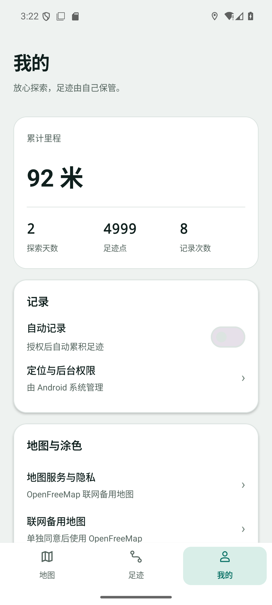
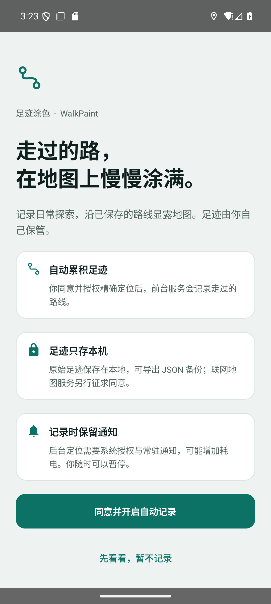

# v0.41 手机 UI 改版候选验收（2026-10-12）

用户原话：“推到GitHub项目呀”“就用这个呀，因为现在的UI太烂了”。关联 [#35](https://github.com/h516df/walkpaint/issues/35)。已将选定设计接入 Android 原生界面，而非仅保存 HTML。

基线：已发布 v0.40 / code42，e4b8301bde9195a9834a19f3d3a7bf72919a97ee。候选 v0.41 / code43 / cn.walkpaint，原签名与 schema2 保持。main 是历史基线；本 PR 的 base 是 dsh/v039-fog，不整合历史 PR 栈。

实现地图真实摘要与暂停/继续、按时间筛选的足迹列表/连续路线预览和详情、我的统计与设置、首次授权说明、浅色/深色/跟随系统。界面采用冷雾白/墨绿/青绿设计；用户已有涂色选择保持。探索日历、统计、诊断与更新安全流程仍可进入。地图沿用最新真实引擎与不透明探索迷雾；原型中的假地图、示例数字和模拟权限弹窗未进入成品。参考在 ../design/mobile-redesign/reference.html。

## 已验收

- 301 项 JVM 测试，0 失败；正式包构建及 release lint 通过。
- 专用 Google AVD：emulator-5556 / WalkPaint_Google_API36 / Android 36 / x86_64；实际启用 OpenFreeMap/MapLibre 备用地图，非 ARM 高德。
- 正式通用包 SHA256：64841c507972117250b60c7cb9742fc8d0be2ac5796278227cb90c282f1d4402。
- 实际点击地图暂停/继续、全部/本周/本月、详情至真实历史地图、深浅主题、检查更新（离线当前版本）、授权引导跳过、系统备份选择器与诊断入口；320dp 实际渲染。状态栏、底部摘要与缩略图已据实际截图修正。
- 原 v0.40 五表旧行逐行摘要均保持：8 trips、4,980 points、0 roads、114 road_matches、0 coverage。测试期间系统继续新增模拟定位，故整表摘要不同；只读守卫验证所有原行，未把数量增加当保留证据。
- 视口、主题和自动记录状态已恢复；未修改系统定位权限、地图授权或用户数据库。临时 UI dump 已清理。详见 acceptance.json 与 original-rows-check.json。
- ARM64 正式候选：65971959 字节，SHA256 8cf874b2a0616e10633ef45123b9275471a0de255c2b4911bc1d8a7f1ef29496。包名/版本/原证书/ARM64/非调试属性校验通过；3 个 dex 与上述实际验收通用包逐字节一致。

## 未验收与发布边界

用户已确认手机当前 v0.40；安装状态未能直接读取；vivo ARM 高德、本轮本人账号设备授权至下载安装、长时间户外后台未验收。#6/#17 保持开放。不能把备用地图通过当高德通过，不能声称新版已在用户手机生效。

本轮推送代码/PR与候选，正式 Release 是否开放以 GitHub 实时状态为准；不自动合并历史 PR。后续发布使用 scripts/publish_release.py 和 dist/v0.41/input 内两个已验收正式包，禁止覆盖 v0.40。回退须原签名/schema2/code>=43 的修复包，不卸载、清数据或降版。

