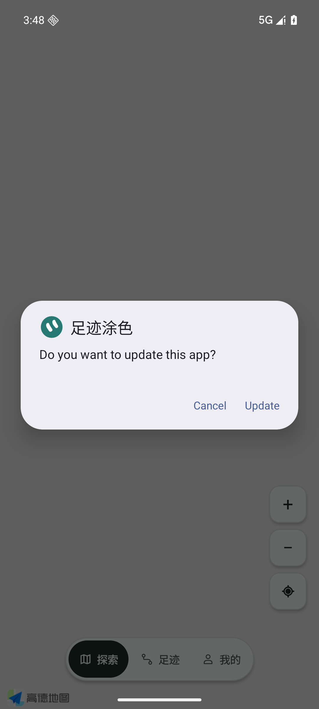
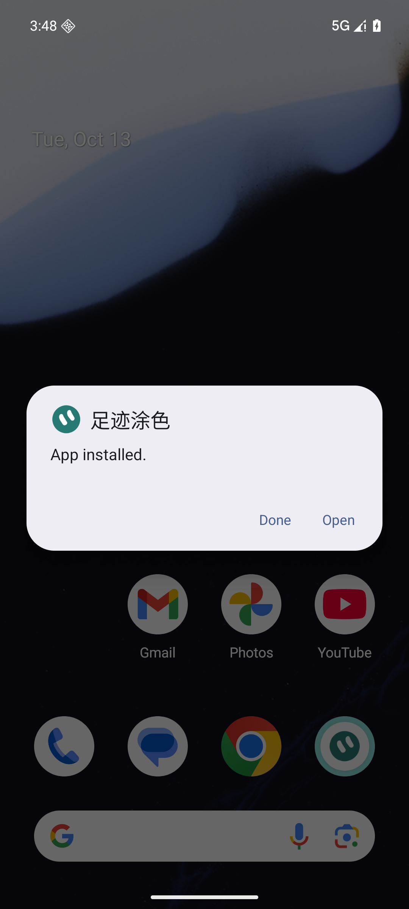
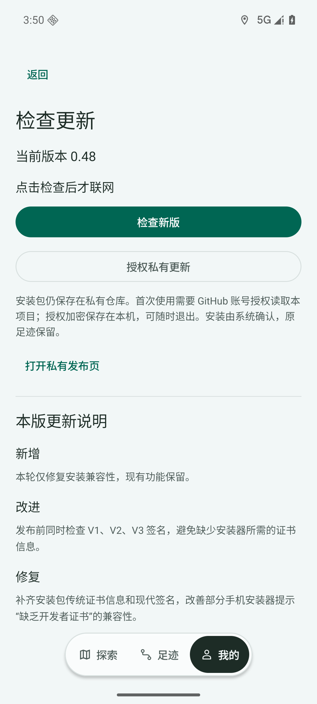

# v0.48 安装证书兼容修复

用户报告：软件包似乎无效，安装包缺乏开发者证书。基线 v0.47 / 45c3fc269602115714800db19ad61719845bcf23，Issue #60。

重新下载私有 GitHub 实际 v0.47 ARM64 包，65971887 bytes，SHA256 92c8ef5ab682ee889e3475def1b8dc44828a2d210c084f7b6447e7d44da4597a，与已发布摘要一致。原证书有效，V2 验证通过；ZIP 没有 CERT.RSA/CERT.SF/MANIFEST.MF，缺少 V1，V3 未启用。**这证明构建兼容性缺口，不证明 vivo 唯一根因**；Android 7+ 标准接受 V2，不能称旧包完全未签名或远端损坏。

现在显式开启 V1/V2/V3，沿用原身份，0.48/code50，非 debuggable、ARM64、schema2；不更换证书，不修改定位/地图/数据库/生产安装 Intent。发布工具分别验证现代签名、传统签名及同一证书，缺任何一项停止发布；传统验证强制 23..23 仅用于评估 V1，不代表 App 支持 Android23。apksigner 在 minSdk>=24 时默认会跳过 V1，所以不能把默认 verbose 的 v1=false 当作新包缺 V1。加入 Windows CRLF、旧 V2-only、缺 V1/V2/V3、不同现代/传统身份门禁回归。

正式 APK SHA256：32580e4da44dc0d24add869c459028929515bc07ec1657660cb0fb01a89476ae。原证书：21b74e3e2a10e12da8284d4e6bd7d99e55b00a385215902e94d7896f7a46c967。生产源码指纹、测试 APK 指纹见 v048/build-receipt.json。

## 验证

- 334 JVM 测试，39 Python 测试（scripts23、tests16）通过；ZIP 完整性通过。
- 同一 APK 在独占 emulator-5560 / WalkPaint_Google_API36_V044 / Android16，确实经生产 FileProvider 的 content URI、APK MIME 和 READ grant 进入 Google 系统安装器。正式包未用 adb install；adb 仅更新 test APK。系统先允许此测试来源，然后再次请求：出现“Do you want to update this app?”，点击 Update，出现“App installed.”。
- 原版本0.47/code49覆盖到0.48/code50；读回 installed APK SHA 等于候选；实际更新页面显示当前0.48。原7行程/4865点，五表逐行摘要和完整性检查全部保持；主题、自动记录开关、日期记录保持。测试来源许可恢复 default，外部测试 APK/ready 标记清理。测试用私有 cache APK 保留在专属 AVD 内，可随 AVD 回收；没有清空生产更新缓存或真实足迹。
- APK 是手机 ARM64 包，Google AVD 通过 native bridge 转译；生产更新器按首选 x86_64 拒绝 ARM-only 是既有正确策略，**未放宽**。只有 test APK 中固定到 sdk_gphone64_x86_64 的 staging probe 在最后 ABI 检查拒绝后继续系统 UI，因此此证据证明相同 APK 的签名/FileProvider/系统安装/数据保留，不代表生产 OAuth 下载及 prepareInstall 全链或本人 ARM 手机完成。
- 第一次 test probe 提前 finish 会杀调用方，安装窗口随之消失；改为保持调用方存活至系统替换。替换后 instrumentation 的“Process crashed”是测试进程随包替换结束，不能当成功判据；成功判据为系统 UI、安装版本/哈希及数据读回。此前界面按钮文本/来源设置返回测试失败已保留在本地，未冒充产品通过。

## 实际手机边界

本人最后可见0.45/Android16；当前未连接本人 vivo。无法读取本人失败下载包、系统安装器日志或确认本人已升级。#60 保持开放至本人路径确认；GPS/FPS/OAuth仍未验收。无需卸载旧版，升级与回退均同证书/schema2/code>=50，不覆盖既有 Release。

依据：[Android 签名方案](https://source.android.com/docs/security/features/apksigning/v2)、[官方签名配置](https://developer.android.com/reference/tools/gradle-api/9.0/com/android/build/api/dsl/ApkSigningConfig)。
