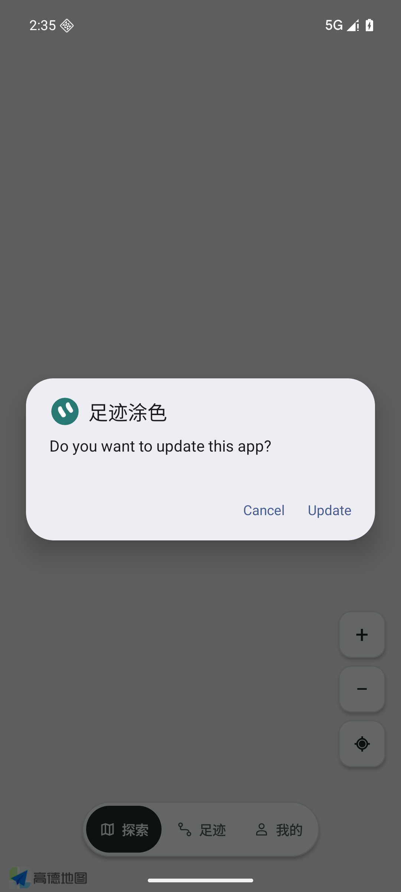
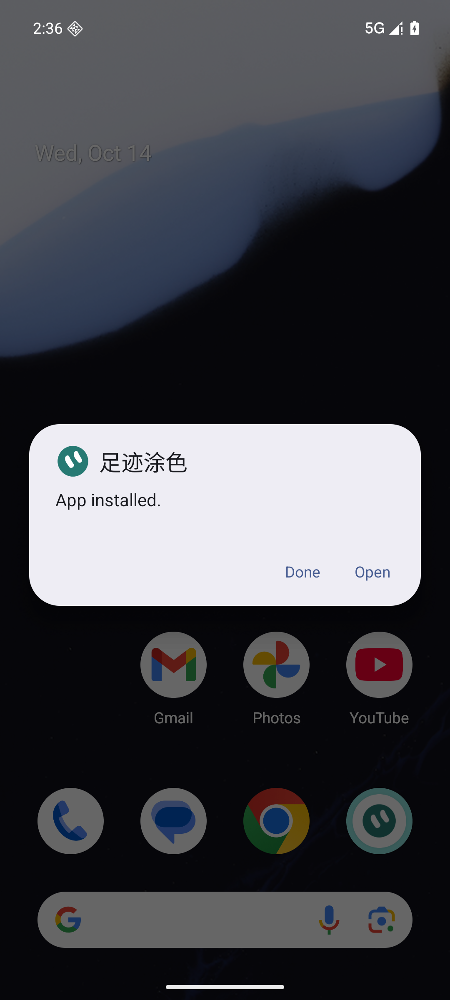
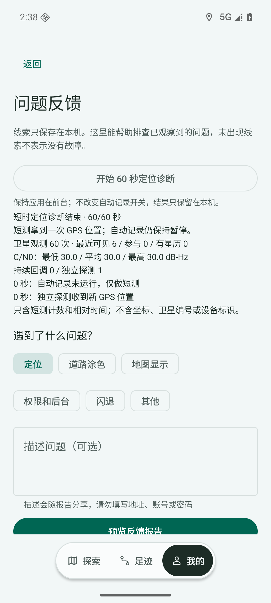
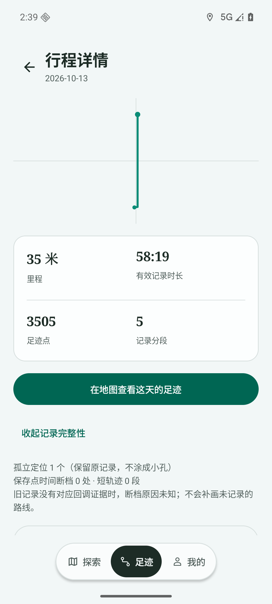
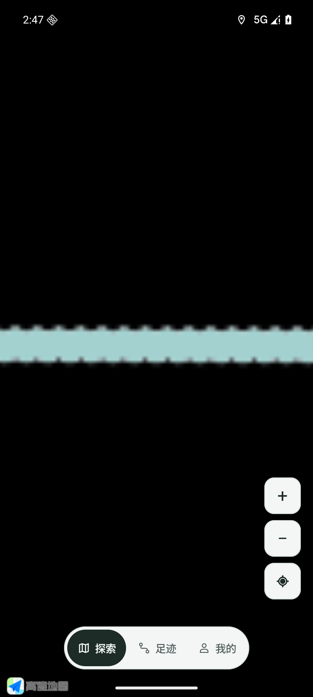

# v0.49：可信轨迹、有限GPS恢复与诊断精简

基线：v0.48 / 491dd493a0052753ab60bc7e00c198e60597bfe7。用户本人报告已经运行0.48/Android16：本次服务62秒、持续GPS回调0，可见52/参与0，历史回调34038秒前；另有地图孤点截图。原图和个人路线没有上传。本轮目标与停止边界见 #62；短测 #55，后台轮询属于 #30 的部分修复。

## 修复与边界

- 旧代码相同坐标间隔46秒会绕过移动检查，已用原编译类与修复前失败回归复现。时间断档现在只影响分段；静止不因此变为运动。60秒/32观察窗口保留真实定位，运动确认后保存4米几何转折及约30秒时间锚；无插值、无旧轨迹重连。批量SQLite原子提交，实际写入数更新诊断，备份每批最多触发一次。
- 至少两个不同坐标且累计3米的片段才交给迷雾和路线显示。孤点/零长度保留数据库，显示不挖孔。真正短线保留。当天详情显示孤立定位、保存时间断档及短轨迹；没有历史回调证据时原因未知。
- 首次搜星180秒；曾有持续回调后90秒断流开始独立15秒探测。每次断流最多重注册一次，探测至少间隔5分钟；只有持续回调重置恢复状态。单次探测不能宣称连续记录恢复。API30+使用原生getCurrentLocation，严格拒绝缓存/未来/过期位置；临时监听沿用原截止时间。26–29编译支持临时监听分支，未在该系统版本实测。
- 状态使用本次单调接收时间，历史另列；通知标题反映实际状态。网络位置为空心标记并可点开说明。退出10解释为REASON_USER_REQUESTED；新线索核对记录进程，旧线索进程归属未知，不归因厂商或某次操作。
- 问题反馈中60秒短测仅保存内存汇总：可见/参与、C/N0、星历、持续与独立探测及恢复事件。离开前台取消，保持原自动记录选择；无坐标、卫星编号、NMEA或设备标识。原始计数和旧道路复算折叠；总点数使用SQLite口径。
- onPause停止两秒UI轮询，onResume只启动一个；不停止记录服务。备份数量进入相关页面时读取，备份变化更新缓存。

## 实际产物及环境

最终候选0.49/code52，非debuggable，ARM64，schema2。APK 66,029,970 bytes，SHA256 `5af07513c19f061a39727764834eeae5ad28d5f6cbeefa2cf4b847d591ab82fc`。原证书 `21b74e3e2a10e12da8284d4e6bd7d99e55b00a385215902e94d7896f7a46c967`，V1/V2/V3通过；V1单独使用23..23验证，因为默认minSdk26验证会跳过传统方案。

只有专属 emulator-5560 / WalkPaint_Google_API36_V044 / Android16 被操作。相同最终ARM64正式包实际加载高德JNI `libAMapSDK_MAP_v11_3_100.so`，map-loaded与安装摘要通过，禁止备用实现冒充。AVD使用ARM native bridge；生产更新器仍按首选ABI拒绝ARM-only在x86设备。只有固定Google AVD测试staging在最后ABI拒绝后进入系统UI，不证明本人OAuth/下载/安装全链或真正ARM手机。

首次候选code51通过安装后，真实UI复核修正文案和证据归属；最终code52重新通过系统FileProvider覆盖安装。系统明确显示App installed，已安装摘要与最终候选相同。Instrumentation随包替换结束的Process crashed不作为成功判据。

## 验证结果

| 范围 | 结果 |
| --- | --- |
| JVM | 轨迹独立提交340项；GPS及最终组合348项通过 |
| Python | scripts23 + tests16 = 39项通过 |
| SQLite | 隔离真实库：运动/断档、批量中途失败回滚、清除故障后继续保存通过；库、文件和设置全部隔离 |
| 原数据 | 原7行程、4865点，五表逐行摘要与设置在两次系统覆盖和全部原生测试后保持相同 |
| 服务/生命周期 | 实际快速暂停/恢复保持最新选择；真实Home退后台，轮询取消但服务仍运行；原生独立探测取消16秒后无迟到结果 |
| 显示像素 | 单点、重复同坐标的零长度路径中心完全不透；走过的走廊、未知区域、空选择及宽视角像素回归通过 |
| 压力地图 | 9000点/145段/约131.8km匿名内存夹具；没有写入真实SQLite历史 |
| 切页 | 四次返回探索保持同一高德实例，ready 30–66ms；只是ready观察，不是FPS/完整无卡顿证明 |
| 当天 | 4650点当天夹具，迷雾只含当天，marker为当天末端；取景误差0.141m，定位当天误差0.037m，日期保持 |
| 缩放 | 快速4次缩小17→13、放大13→17，混合与最大缩放边界通过；中心偏移0.115m |
| 动画遮挡 | 25张过程画面，每张1044个已确定未知区域采样，最低黑色比例1.0，已知走廊同时可见；采样有额外开销，不冒充FPS |
| UI | 60秒短测完整结束、开发者折叠、备份数、实际当天详情完整性、缩放日期保持、320dp滚动可达性通过 |

测试修正也留痕：旧数据库探针把简化路径点数误当原始点数，改为分别断言原始5+2和显示2+2；其临时库原来共用全局备份目录，现在文件/设置隔离且不再追加全局测试行。Windows原始文本换行差异曾触发保留断言，最终比较的是五表内容摘要。窄屏脚本曾要求四个入口同时可见，现在按实际滚动可达性检查，没有假称全部同屏。

## 未测与后续

本人vivo未连接。本人户外/锁屏/后台长期GPS、完整帧率和本人账号授权更新链未验收，#6/#17继续开放。模拟器定位/卫星数据是测试环境，不能证明真实天线、信号或系统问题已经消除；52可见/0参与与当前0回调不能唯一诊断物理根因。备用地图网络标记已编译且共享显示条件，未单独做其真实渲染验收。

备份容量/完整序列化锁 #51、增量恢复 #52 仍是高优先级；GPX #53依赖#52，时间播放#54暂不实施。#30仅完成后台UI轮询和备份数量读取，不能冒充全部能耗验收。

发布使用上述已安装APK，不重建替换。源码配置指纹、两个测试包指纹、实际安装/数据与原生结果在 `v049/`。正式整合目标始终 `agent/codex/mobile-ui-redesign-v041`，不向旧main恢复任务。回退需原证书/schema2且versionCode不小于52的修复包；不得卸载清数据、降级或覆盖旧Release。
