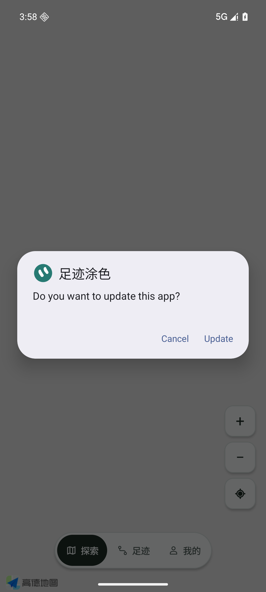
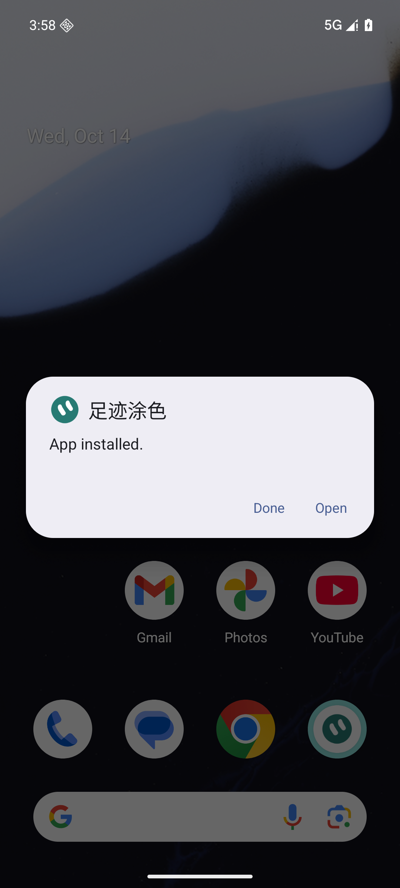
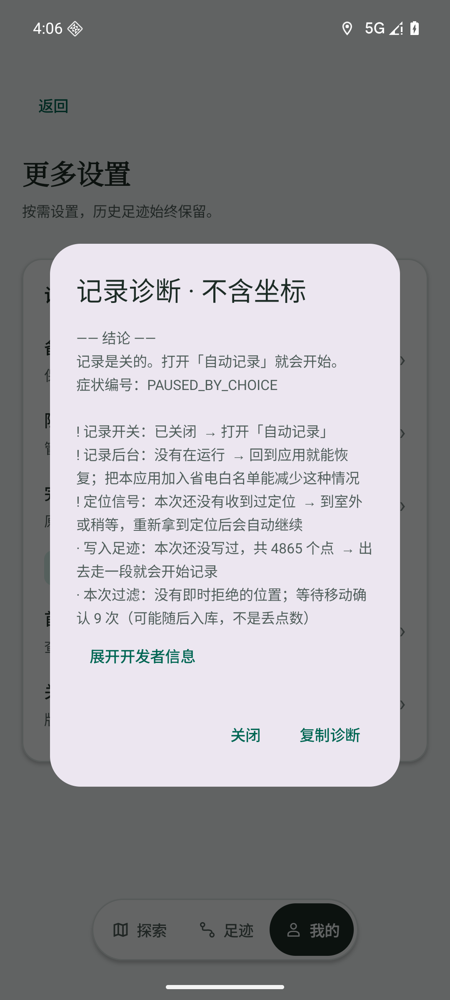

# v0.50：等待确认与即时拒绝分开

最终对抗核对发现v0.49诊断缺陷：首颗有效GPS与自己比较，被错误归为NON_INCREASING_TIME；实际还留在暂存窗口、随后可能随批入库的点被计为过滤/丢弃；刚恢复时还可能借历史保存年龄过早判断走路被过滤。Issue #66。v0.49已经正式发布，保持不覆盖，以0.50/code53发布最小补丁。

现在首颗有效点等待移动确认；pending计数独立于即时拒绝，诊断与反馈说明可能随后入库、不是丢点统计。走路过滤告警至少经过本次180秒。SQLite格式/写入、定位订阅及恢复策略、地图几何、导航与缩放不变。

最终正式ARM64 APK：66,030,045 bytes；SHA256 `f73460ea2943f9503f4c94e0dbd91cc74b98838f1d0080d239bcff942ad73ab8`。原证书V1/V2/V3、非debuggable、schema2；原签名和生产ABI策略保持。

验证：351 JVM通过，包括首点暂存、暂存后提交不增加即时拒绝、本次初期不借旧保存年龄报警。39 Python检查的源码未变化，复用v0.49通过结果。专属5560/WalkPaint_Google_API36_V044/Android16，同正式包实际FileProvider系统覆盖52→53，App installed、安装SHA、原五表7行程/4865点及自动记录false/主题0保持。临时来源许可恢复default，外部staging清理。

实际录制服务：向专属AVD发送固定公开巴黎坐标，持续真实Android位置回调使pending>0，时间拒绝=0；快速暂停恢复、Home退后台轮询停止而服务保持、取消探测16秒后无迟到回调、原库保持通过。这是模拟定位协议测试，不是本人真实GPS。当前诊断界面能看到等待确认，没有“丢下”混用。最终同APK实际高德JNI/map-loaded/SHA通过。

地图/迷雾/存储未改，v0.49的9000点145段/25张未知像素/当天/切页/快速缩放/隔离SQLite证据仍说明那些未变模块，详见[V049](V049.md)；不是假称在0.50重复了完整FPS或本人验收。0.50只对受影响的诊断/服务路径和实际更新/地图启用重验。

本人vivo长期户外/锁屏GPS、FPS和本人账号授权更新链仍未验收，#6/#17保留；备份#51/#52、GPX#53和播放#54仍独立跟进。AVD依旧以ARM native bridge运行相同包，只有固定Google AVD测试staging例外；生产ABI校验未放宽。不卸载/清库/降级/覆盖旧Release；回退使用原证书/schema2/code>=53修复包。
