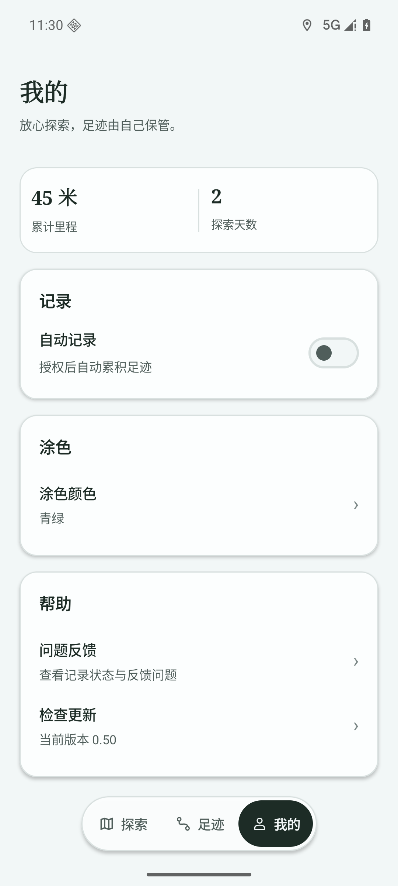
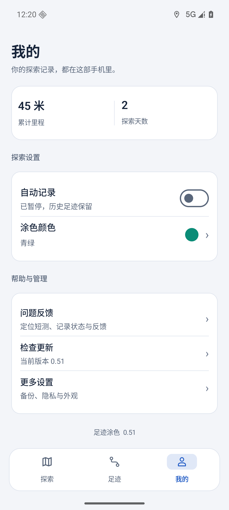
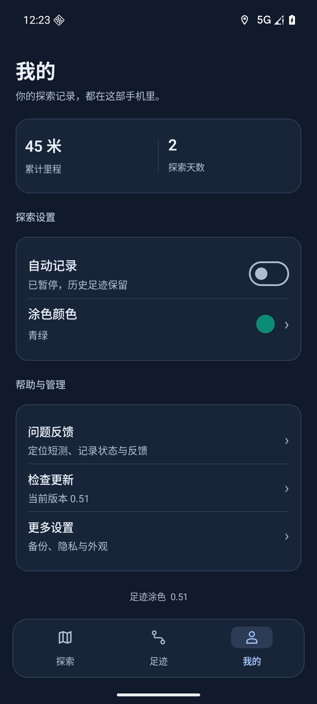
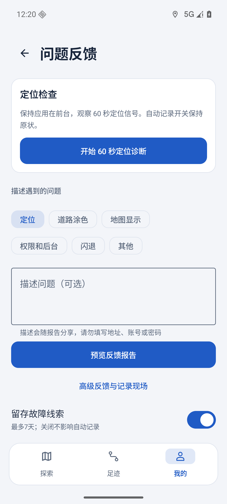
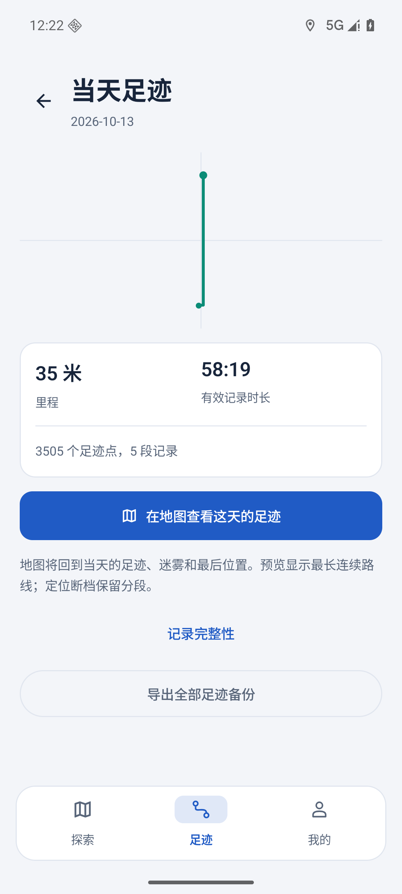
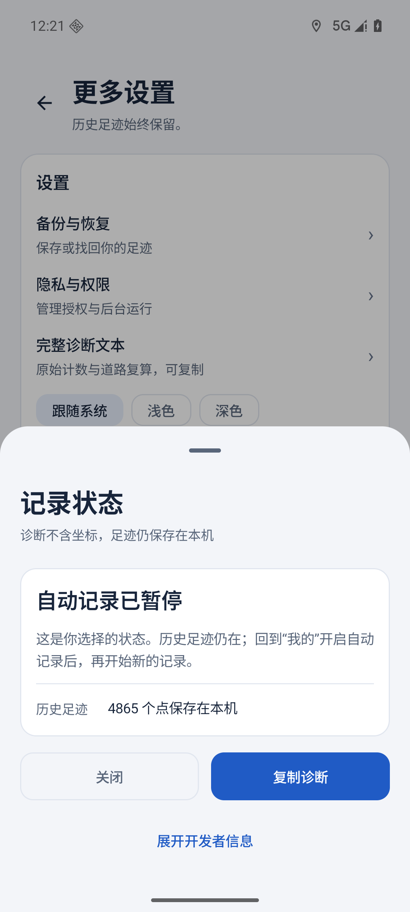
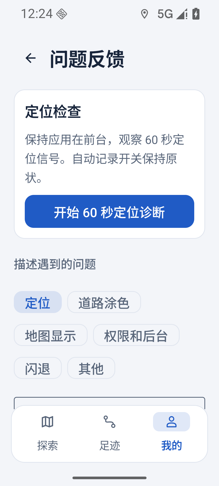
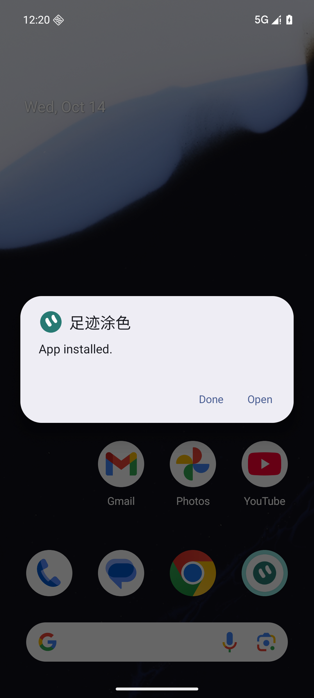

# v0.51：原生 UI 重绘

用户最新原话：“UI太丑了，你来改进吧，别用open desgin了”。Issue #68，Codex 唯一写手，直接修改原生 Compose，未调用 OpenDesign Cloud/Local Codex 或设计委派。正式基线 db0b5b862f82e76ca834e04f49c20b2af5a586e4/v0.50；目标分支 agent/codex/mobile-ui-redesign-v041，main 仍是历史基线。

底部三入口保持探索/足迹/我的，改成图标与文字分行的导航；地图控制为深蓝缩放组合与独立定位，减少刺眼白块。统一蓝色、系统无衬线字体、轻量分组。我的集中探索设置和帮助/管理，保留距离与天数。足迹新增最近探索预览，当天详情以路线、里程和回看为主。反馈短测先结论后详情，含坐标的高级报告仍明确提示；更新和子页返回标题统一。诊断改为分层底部面板，暂停属于用户选择，不再误导修复后台或去室外，完整报告可展开、复制。

最后截图核对修正了开关和输入框的弱对比度。最终 0.51/code56，ARM64，非 debuggable，SQLite schema2。APK 66,046,319 bytes，SHA256 `7cb1f9b395c5340fb4e706fea9e5fbc525c82f13f735da631eca953eb6a3c8c2`；原证书 `21b74e3e2a10e12da8284d4e6bd7d99e55b00a385215902e94d7896f7a46c967`，V1（单独23..23验证）/V2/V3。54/55是本机迭代包，未发布。已接受包固定 dist/v0.51/input，发布不得重建替换；87个生产文件指纹见 production-sources.json，整合后须逐项一致。

最终包验证：354 JVM，39 Python；仅操作专属 emulator-5560/WalkPaint_Google_API36_V044/Android16。真实 FileProvider/ACTION_VIEW 系统覆盖到56，App installed、安装SHA、原五表7行程/4865点全部哈希和记录false/外观0一致。同 ARM64 包经 Google AVD native bridge，实际高德JNI `lib/arm64-v8a/libAMapSDK_MAP_v11_3_100.so`/map-loaded/SHA匹配；只在固定测试AVD staging接受最后的ARM翻译ABI差异，生产安装校验未放宽。

真实UI七项均通过：当前说明/网络错误/返回，分类与描述进入报告，高级坐标警示，诊断复制/关闭/展开/折叠，当天地图/放大缩小/定位当天/返回，深浅色与开关轮廓，320dp/130%字体下分类自动换行、滚动填写表单与报告结果。窄屏长页面允许滚动，不将所有内容同屏作为条件。系统剪贴板浮层会短暂遮挡，复制后等待其消失；底部面板用真实关闭/返回，不复用会拖动面板的整屏滚动。临时字体、尺寸、安装来源均恢复。

地图重验同最终包：9000点/145段/131.8公里显示夹具，只在内存替换并finally恢复。四次切页保持同一个地图，ready 20, 78, 6, 138ms（不是FPS）；选日只显示4650个当天点、当日迷雾和末点，定位仍留在当天。真实SDK17→13→17、混合快速缩放和最大20再退至19通过。25次有效场景采样，每次1044个固定未知点全部黑色，已保存核心持续可见。夹具初始纹理上传有一张灰色等待帧，在场景成立前，不计入25次缩放采样；这里不声称冷启动首帧或零卡顿已验收。map-pressure.png来自最后通过的场景26。原五表/设置后验仍一致。

60秒短测完成与详情切换在同本轮code55实测；最终56仅修改主题outline对比度和版本元数据，FeedbackPage/GpsSurvey实现指纹完全相同，受影响最终界面已复验，不假称重复了60秒或本人GPS。UI本轮未改定位恢复、轨迹筛选、迷雾几何、数据库或更新授权协议。

本人vivo未连接，最新本人报告仍0.48；本人户外/锁屏GPS、帧率和本人GitHub授权下载安装未验收，#6/#17/#60边界保持。已有备份#51/#52、GPX#53、播放#54不在UI改版范围。回退为同证书/schema2/code>=56修复更新，不卸载、不清库、不降级、不覆盖旧发布。

发布状态以实际 Release 和本机 work/v051/handoff.json 为准。
