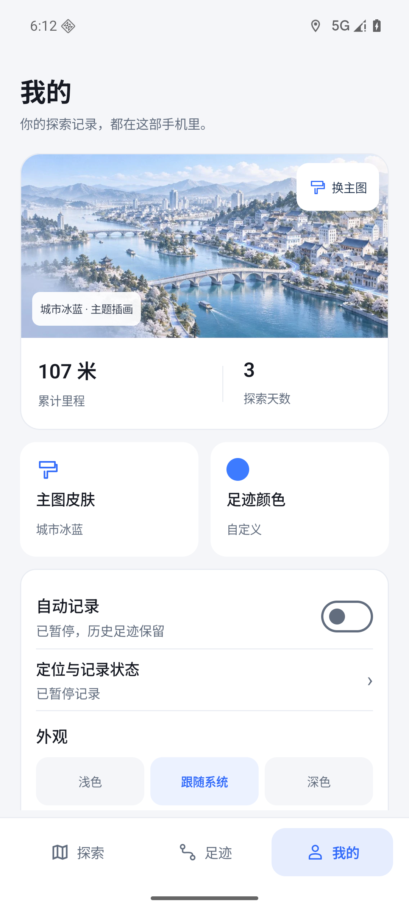
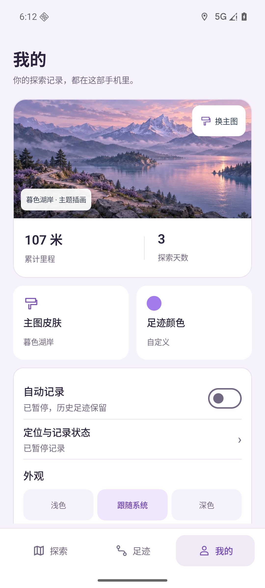
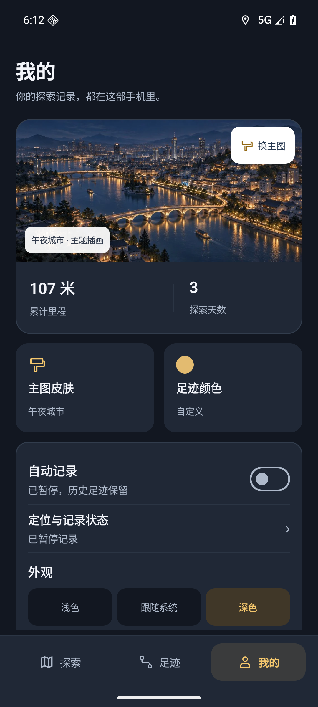
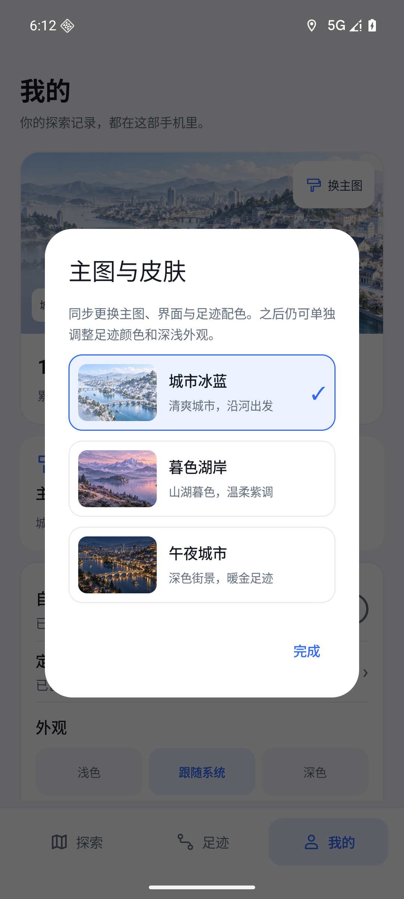
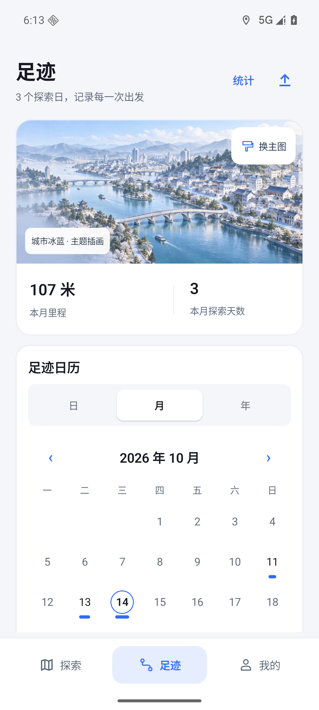
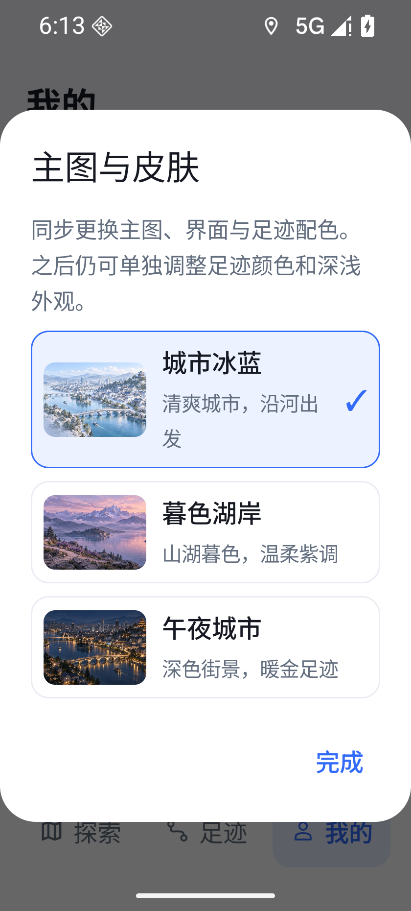
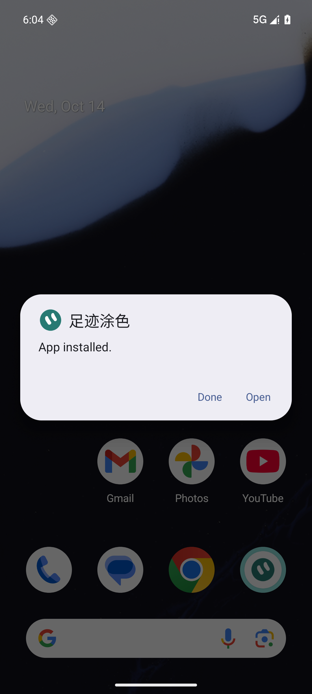

# v0.52：认可的主图皮肤、通知刷新与 GPS 恢复

用户原话：“可以，做吧”“通知栏的定位，一直都是那样，没变”“GPS定位不是那么好用”。#70/#71，Codex 单写手，分支 agent/codex/skins-location-v052；基线6198180437689dba693744f3ebeaea599c5db609/v0.51，正式目标 agent/codex/mobile-ui-redesign-v041，main仍为历史分支。按认可的冰蓝主图方案实现原生 Compose，未使用 OpenDesign 或其他设计委派。

## 结果与边界

三套本机皮肤：城市冰蓝、暮色湖岸、午夜城市；主题插画约336KB WebP，默认加载城市冰蓝且不改已有足迹颜色。只有明确选择皮肤才同步界面/足迹颜色，午夜默认深色；之后可分别修改外观和足迹颜色。偏好重启保留。底部探索/足迹/我的使用横排图文，地图控件按预览调整；主图仅在足迹/我的，地图黑雾和真实几何保持。

足迹主图显示本月真实里程/探索日；我的保持累计真实里程/探索天数。皮肤、颜色、定位状态、外观和备份直接可达，保留日历各粒度、反馈、更新、隐私与系统权限管理。没有演示统计混进生产数据，也没有把插画当作地图。

通知原实现30秒内直接返回、丢弃变化；新快照统一标题和正文，状态变化立即发布，正常高频更新合并到30秒截止时间，不丢弃末次更新。显示GPS回执年龄、可靠精度与本次SQLite实际提交点数；缺位置/弱信号不展示假精度。网络蓝点不作为GPS足迹。

GPS原策略将未注册成功的重试与已订阅断流的一次重注册共用限制。现在未成功订阅每30秒重试，包括首个请求的退避；成功订阅仍遵循首次180秒、断流90秒、15秒独立探测、至少5分钟探测间隔、每次断流一次重注册。过期回调只算回执，不能重置恢复时钟。唤醒/电源状态改变及时复核，不增加第二个健康循环、不持有CPU锁、不放宽35米精度和断档分段。

## 最终包与证据

0.52/code58，ARM64，非debuggable，schema2；原证书21b74e3e2a10e12da8284d4e6bd7d99e55b00a385215902e94d7896f7a46c967，V1（独立23..23）/V2/V3通过。APK 66,417,113 bytes，SHA256 `513dff652ec7482e975e409a29f0f8bb8af2076f32ce6472b860b5d405e73e58`。固定dist/v0.52/input/WalkPaint-v0.52-arm64.apk，验收后不重建替换；95个生产文件规范化哈希见production-sources.json。57只用于本机迭代，未发布。

360 JVM/39 Python全部通过。先用failedRegistrationRetriesWithoutWaitingForColdAcquisition复现旧策略失败（第9行），再修复并通过。新测试覆盖初始注册退避、状态变化绕过节流、普通更新截止时间、无定位/弱信号与皮肤偏好ID。

只操作专属emulator-5560/WalkPaint_Google_API36_V044/Android16。系统FileProvider/ACTION_VIEW覆盖56→57→58、可见App installed与安装SHA一致。56→57时原五表7行程/4865点完整哈希与原青绿色/自动记录false/外观0保持；主动皮肤选择后颜色变化属于预期。GPS验收在专属AVD追加公开巴黎模拟点，原五表前缀行哈希逐项保持；没有清库或删除原行。

最终58实际Android LocationManager→前台服务→NotificationManager链路通过：关闭/开启手机定位、240米弱精度、8米有效GPS、移动后实际保存5点、再次关闭/开启、拒绝120秒过期点、新鲜回调恢复。发送Home后停止投递，通知在最近GPS54秒时显示断流；随后恰好一次独立探测和重注册，服务保持运行，新回调恢复正常；暂停后服务/通知均停止。详见notification-native.log；这不是本人户外GPS。

最终58复验原生三皮肤/夜间金色按钮/重启偏好/真实统计/320dp和130%字体/诊断入口。57已完整验收当天日历→当天地图/缩放定位→全部探索、诊断、备份、更新版本与反馈入口；58仅变更GPS时间顺序与首次退避、皮肤按钮tint和版本code，相关页面实现保持，最终受影响路径已重测。截图code57前缀明确来源，不冒称58截图。

最终58实际高德JNI11.3.100/map-loaded/安装SHA匹配，Google AVD使用ARM native bridge，生产更新ABI校验未放宽。9000点145段内存夹具：4次往返保持同地图实例；当天4650点只显示当天迷雾与末点；实际SDK17→13→17、混合快速缩放、最大20退至19；25次有效场景每次1044未知位置全部黑色，保存核心持续可见。内存夹具finally恢复，不写这些9000点到数据库。不把ready时间或25帧采样当作FPS/零闪屏/零卡顿证明。

## 限制与回退

本人vivo未连接，本人户外/锁屏/厂商后台策略、本人GitHub授权下载安装和真机FPS均未验收；可见52/参与定位0不能唯一断言App、信号或系统根因。#6/#17/#60继续保持，#51/#52备份、#53GPX、#54播放不在本次范围。回退使用同签名/schema2且code>=58的修复更新，不卸载、不清库、不降级、不覆盖旧发布。本轮未重启DSH或独立手机隧道。

发布与合并状态以实际PR/Release和本机work/v052/handoff.json为准。Android官方行为参考：[通知更新](https://developer.android.com/develop/ui/compose/notifications/create-notification)、[LocationManager](https://developer.android.com/reference/android/location/LocationManager)。

