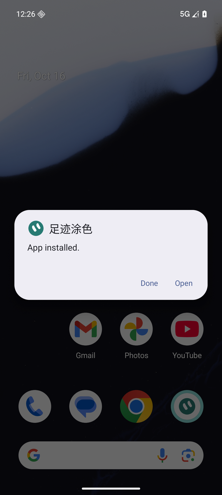
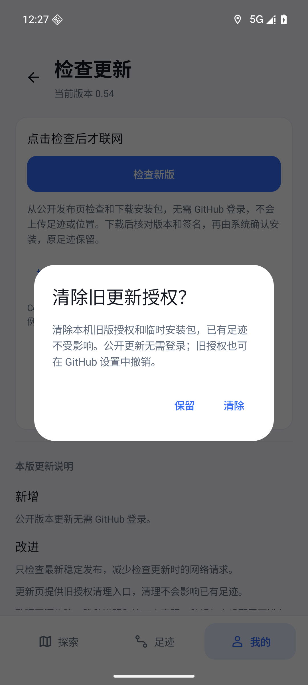

# v0.54：公开准备、GPL许可与匿名更新

用户授权隐私整理后将原仓库公开，并选择GPL-3.0；只维护原仓库，不创建另一套私有源码仓库。基线为已发布0.53/code59/schema3，最终候选0.54/code62/schema3。

## 范围与来源

代码GPL第3版，附高德SDK链接许可；第三方SDK、地图数据与服务保留各自条款。许可及第三方声明已与APK内资产逐字节比对。三幅主图的AI生成记录、JPEG图集和WebP裁切链已核对；三张WebP从公开图集重新编码，字节均与现有资源一致，没有替换皮肤或输入个人照片。

历史隐私审查见[公开前审查记录](../PUBLICATION_REVIEW.md)。原始导出、脱敏扫描细节及镜像恢复副本留在Git之外。未确认真实凭据、联系信息或私人路线泄露，未因误报重写历史。签名私钥与本机Key不在源码仓库中。

## 代码与固定产物

生产源码提交`0dc71f878175625bfee88b281458ce06be97f1ca`，107个生产源/构建文件的Git规范化内容摘要见[production-sources.json](v054/production-sources.json)。后续整合或证据提交如只改文档，应核对此清单，不能仅凭版本名复用产物。

ARM64正式APK：66,431,034 bytes，SHA256 `f7d6e99d5599fd8e5853c07459cf3431a24cb702c2aea914c948eca83a361b6d`，非debuggable；原证书SHA256 `21b74e3e2a10e12da8284d4e6bd7d99e55b00a385215902e94d7896f7a46c967`。发布器验证包名、code62、版本0.54、ARM64、V1独立23..23及V2/V3，固定输入为dist/v0.54/input-code62，验收后不重建替换。

390 JVM测试、41 Python测试通过；最终受影响源码再次运行390 JVM、assembleRelease、assembleDebugAndroidTest和完整lintRelease通过。独立开发构建无需正式私钥，使用cn.walkpaint.dev；开发模式不接收正式包更新，不削弱正式签名校验。

## 实际Android验收

仅操作专属emulator-5560/WalkPaint_Google_API36_V044/Android16 Google x86_64，手机ARM64包通过ARM native bridge运行。原生产ABI策略未放宽；安装前测试工具显式识别此模拟器桥接边界。不是实体手机证据。

真实FileProvider/ACTION_VIEW与系统安装对话框完成59→60→61→62覆盖，最终观察“App installed.”并从系统安装路径拉回APK，大小/摘要与最终固定包一致。60/61仅本机候选，未发布。冷启动系统UI曾无响应，选择等待后恢复；未为此修改App或清库。

升级前后原五张表完整摘要相同：11行程、4905点、0道路、34匹配、0覆盖；自动记录false、外观0、city皮肤、自定义颜色均保留。没有卸载、清库、导入个人数据或追加GPS夹具。最终摘要见[data-after-code62.txt](v054/data-after-code62.txt)和[state-after-code62.txt](v054/state-after-code62.txt)。

通过“我的→检查更新”真实页面确认无需授权按钮，保留检查/发布页及源码许可入口。原生测试先发现旧授权仅检查联网后才显示清理入口；code62在Activity启动加载本地快照，未点击检查新版即可显示清理。使用专属AVD的纯本地合成授权，经真实清理确认对话框操作；[原生结果](v054/legacy-cleared-code62.txt)确认偏好为空、Keystore密钥移除、临时包缓存为空，五表摘要不变。未使用或撤销任何真实账号令牌。

## 发布与限制

本文提交时仓库仍为私有，代码/安装验收已完成；实际公开后的匿名目录、完整下载及读回结果将在公开后补齐。不能用带账号请求代替此验证。

0.53及以前需一次浏览器下载0.54覆盖安装，之后公开更新无需登录。本人手机未连接，本人vivo安装、户外/锁屏GPS、通知行为与缩放FPS未验收。本轮不改GPS/迷雾策略或数据库结构；回退须原签名、兼容schema3、code不降低，不能通过卸载清库或直接安装旧版回退。
