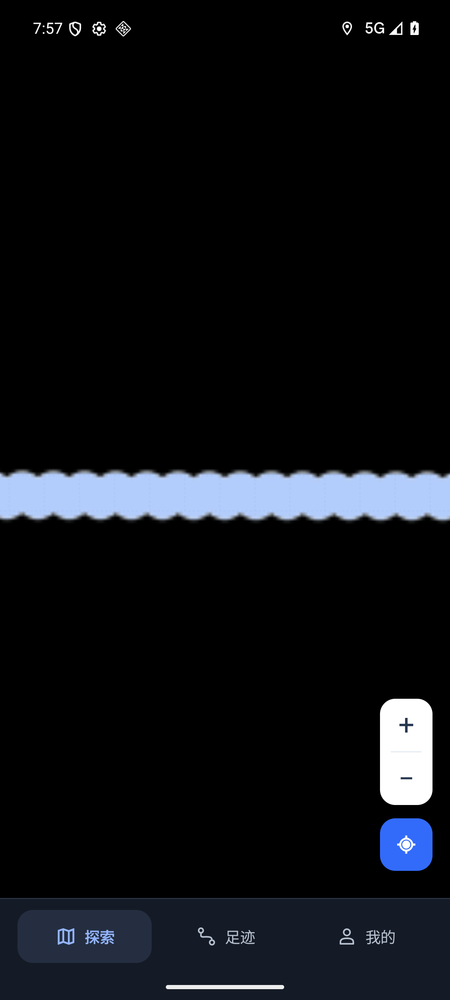

# 0.57 开雾与更新验收

基线 de0b349517a0c43fcc0994da69eec6a2614a423c，0.57/code65/schema3。正式 ARM64 APK SHA256：`d3ee0080a00426f5c5aa4c0dc7dcb00ddaa842439bdf33a6a85ca9f435c3f4cc`，66,431,009 bytes，沿用原签名。

## 用户问题与修复

已接受首点/短段原先被“可展示路线”过滤，未进入开雾绘制。现在真实探索点与路线展示条件分开，首点按真实地面半径清除；不扩大 30 米带宽，不放宽 GPS 接受条件，不连接记录断点。无历史、暂停、等待定位、定位无效时提供状态提示，避免只剩全黑界面而无解释。

匿名 API 限额或网络不可用时，使用同一官方仓库发布文件并验证说明清单；下载中断在同一尝试内按 Range 续传，最多五次，校验大小/摘要/包名/版本/原签名/架构后才允许系统安装。没有代理镜像、用户凭据或校验绕过。

## 本轮证据

- 409 JVM、23 Python 测试、正式构建与 lintRelease 通过。
- 正式 APK 的 FOG_PIXEL_PROBE_PASS：有效单点产生清除，40 米外仍全黑；保留已有像素回归。
- AMAP_RUNTIME_PASS：实际 ARM64 包经 Google x86_64 原生桥接运行，高德 map_loaded=true；未使用备用地图冒充高德。
- AMAP_ALIGNMENT_PASS：北京公开坐标的 SDK 偏移 555.019 米，屏幕中心误差 1.414 像素，迷雾矩阵误差 0。第一次探针与位置跟随争用相机失败；修复探针先暂停跟随/停止动画后重新通过，未为测试改变生产地图实现。
- MAP_SCENE_PASS：9,000 个合成显示点，缩放 13–17 共 25 次实际截图采样，未知区域黑色比例均为 1。截图检查验证覆盖层，不能单凭 map_loaded 声称所有地图瓦片或真实手机网络正常。
- DATA_PRESERVATION_PASS：8 条行程、4,875 点，数据库完整性通过；此记录是最终快照，不冒充未保存基线的逐字节升级对比。原数据没有卸载或清除。
- 官方发布文件真实匿名下载 0.56：66,430,933 bytes，SHA256 `22fa70708adbdb2e8ca0856169f392563508eae822af6c47ef01edc2c3c39a50`。在 20,303,424 / 42,000,896 / 59,014,912 字节处续传后完整校验通过。该网络样本使用模拟器显式测试代理，已恢复原设置；不声称国内任意网络都可直连，也不把测试 installedCode=0 当真实安装。

环境：本任务独占只读 AVD WalkPaint_Google_API36_V044，Android16/API36，x86_64 + libndk_translation.so，正式 ARM64 包。真实用户/女朋友手机、户外持续记录、锁屏和本人系统安装仍未验收。全黑反馈也可能涉及权限或底图网络，本轮只确认并修复已复现的首点/短段原因。

回退使用原签名、schema3、递增 versionCode 的修复包；不卸载清库、不覆盖旧 Release。用户已于 2026-10-18 授权公开发布。

